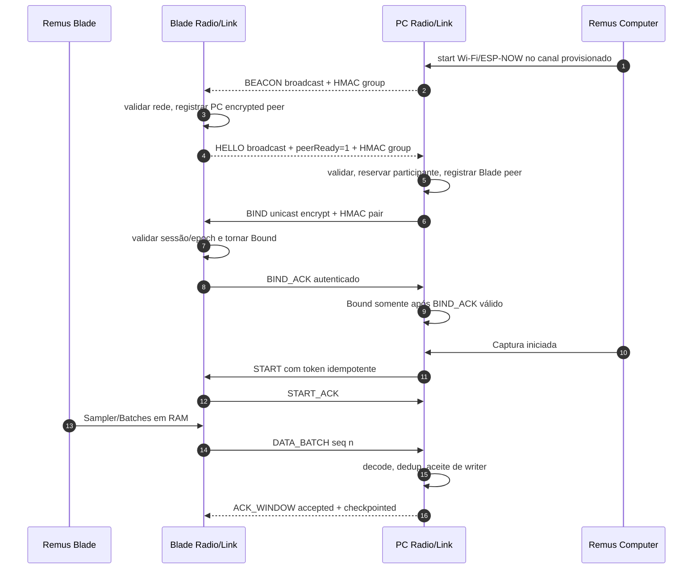
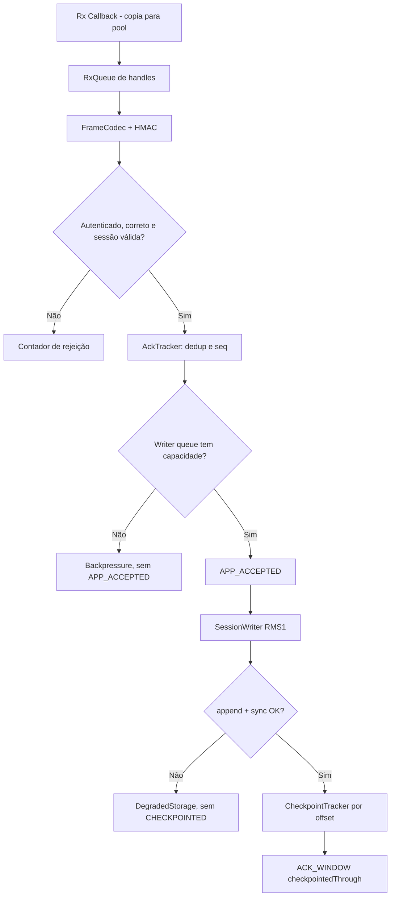

# REMUS FIRMWARE — ESPECIFICAÇÃO MESTRA DE IMPLEMENTAÇÃO

**Documento:** `RFS-001` — Remus Firmware Specification
**Versão:** `1.1.0-draft`
**Data:** 13 de outubro de 2026
**Repositório de destino:** `remus-firmware` (greenfield, novo repositório limpo)
**Estado:** baseline técnico revisado e normativo; implementação condicionada aos gates e milestones
**Leitor principal:** desenvolvedor/assistente de codificação (incluindo modelos rápidos/Codex)
**Hardware-base:** Remus Blade e Remus Computer (PC), inicialmente ESP32-C3 (núcleo único)
**Ferramenta de compilação:** **PlatformIO** com **ESP-IDF**, C++17 (com suporte estrutural dual para `idf.py`)
**Escopo de escala:** de 0 até **8 Remus Blades** por Remus Computer.

> **INSTRUÇÃO VINCULANTE AO IMPLEMENTADOR:** Este é um **projeto completamente novo (greenfield)**. O código legado do `remus-sensor` (como `BladeApp.cpp`, `RemusApp.cpp`, `EspNowComputer.cpp`, `sources_[2]` ou abstrações do Arduino) **NÃO deve ser copiado nem mantido como compatibilidade reversa**. A arquitetura legada continha acoplamentos graves e dívida técnica que não devem ser herdados. Onde estiver escrito **DECISÃO**, implementar como definido; onde estiver escrito **VALIDAR**, produzir evidência antes de escolher; onde estiver escrito **FUTURO**, não implementar no MVP. Trabalho rigorosamente em PRs pequenos por milestone, com TDD estrito.

---

# Índice

1. [Objetivo, pressupostos e escopo](#1-objetivo-pressupostos-e-escopo)
2. [Diagnóstico e lições do remus-sensor](#2-diagnóstico-e-lições-do-remus-sensor)
3. [Decisões arquiteturais imutáveis no MVP](#3-decisões-arquiteturais-imutáveis-no-mvp)
4. [Estrutura exata do repositório e do PlatformIO](#4-estrutura-exata-do-repositório-e-do-platformio)
5. [Mapeamento de componentes e dependências](#5-mapeamento-de-componentes-e-dependências)
6. [Tipos, IDs, relógios e contratos C++](#6-tipos-ids-relógios-e-contratos-c)
7. [Catálogo detalhado de classes](#7-catálogo-detalhado-de-classes)
8. [Máquinas de estado e conexão](#8-máquinas-de-estado-e-conexão)
9. [Protocolo binário Remus RF v1](#9-protocolo-binário-remus-rf-v1)
10. [Aquisição de IMU e agregação](#10-aquisição-de-imu-e-agregação)
11. [Agendamento de transmissão e rádio](#11-agendamento-de-transmissão-e-rádio)
12. [ACK, replay, perdas e checkpoints](#12-ack-replay-perdas-e-checkpoints)
13. [Sessões, escrita no cartão SD e recuperação](#13-sessões-escrita-no-cartão-sd-e-recuperação)
14. [Sincronização temporal e GPS](#14-sincronização-temporal-e-gps)
15. [Concorrência, filas, memória e desempenho](#15-concorrência-filas-memória-e-desempenho)
16. [Provisionamento, identidade e segurança](#16-provisionamento-identidade-e-segurança)
17. [Perfis de hardware e configurações](#17-perfis-de-hardware-e-configurações)
18. [Diagnósticos e observabilidade](#18-diagnósticos-e-observabilidade)
19. [Estratégia completa de testes](#19-estratégia-completa-de-testes)
20. [Etapas e entregas do Codex](#20-etapas-e-entregas-do-codex)
21. [Definition of Done e regras de revisão](#21-definition-of-done-e-regras-de-revisão)
22. [Compatibilidade e migração](#22-compatibilidade-e-migração)
23. [Matriz de riscos e planos de contingência](#23-matriz-de-riscos-e-planos-de-contingência)
24. [Anexos: sequências, fluxos, checklist e prompts](#24-anexos-sequências-fluxos-checklist-e-prompts)
25. [Fontes, premissas e decisões abertas](#25-fontes-premissas-e-decisões-abertas)

---

# 1. Objetivo, pressupostos e escopo

## 1.1 Produto e premissa de operação assimétrica

O Remus é um sistema de aquisição e análise de remo olímpico (extensível a Va'a/outrigger). O sistema compõe-se de dois tipos de equipamentos:
1. **Remus Computer (PC):** instalado no barco (casco). Grava GPS, telemetria de casco, eventos de sistema e dados de 0 até 8 sensores Remus Blade em cartão MicroSD local.
2. **Remus Blade:** instalado nos remos. Sensor inercial ultracompacto que captura IMU de alta taxa e transmite os dados via enlace sem fio direto ao Computer.

### Regra de ouro da arquitetura: assimetria operacional
- **O Remus Computer opera de forma 100% autônoma (com 0 a 8 Blades):** o Computer **não** depende de nenhum Blade para iniciar, registrar e finalizar uma sessão de gravação no cartão SD. Se nenhum Blade estiver ligado ou no alcance, o Computer grava perfeitamente o rastro de GPS, IMU de casco (se presente), integridade do relógio UTC e eventos de navegação. Blades adicionais (de 1 a 8) podem ser admitidos dinamicamente a qualquer momento durante uma sessão já aberta.
- **Nenhum Remus Blade opera sem o Remus Computer:** o Blade **não** possui cartão SD, não tem capacidade de gravação local persistente e não tem relógio UTC. Sem receber `BEACON`, completar handshake `BIND` e receber comando `START` emitidos por um Remus Computer válido, o Blade permanece em estado de espera (baixo consumo) e **não** produz fluxo de dados persistente. Se o Computer sumir permanentemente ou desligar, o Blade drena o buffer circular em RAM, registra lacuna e volta a procurar o Computer, sem inventar sessões locais.

O firmware novo é a **base estrita de aquisição e transporte em tempo real**. Processamento biomecânico pesado, IA, desenho de gráficos ou cálculo de potência pertencem ao software de análise pós-captura.

## 1.2 Requisitos funcionais (RF)

| ID | Requisito | Critério observável |
|---|---|---|
| RF-01 | Blade captura IMU nominal a 200 Hz | Amostras numeradas por `sampleIndex`, `nativeTimestampUs` e detecção de lacunas |
| RF-02 | Blade transmite lotes binários de até 10 amostras | Pacote `DATA_BATCH` versionado, até 244 bytes de frame (limite ESP-NOW 250 B) |
| RF-03 | Blade continua capturando durante falha temporária de RF | Aquisição desacoplada de `esp_now_send()`; buffer circular com GAP explícito em caso de saturação |
| RF-04 | Computer suporta de 0 a 8 Blades concorrentes | Registro dinâmico de participantes sem arrays estáticos de 2 e sem IDs hardcoded |
| RF-05 | Computer grava sessão completa com 0 Blades | Gravação no SD de GPS, eventos e IMU local mesmo sem sensores remotos |
| RF-06 | Descoberta e associação independentes de ordem de boot | Blade pode ligar antes ou depois do Computer; BIND e START idempotentes |
| RF-07 | Cada dispositivo tem identidade persistente única | `deviceSerialNumber` em NVS; desacoplado de endereço MAC e de assento/lado |
| RF-08 | Amostras contêm proveniência física e de calibração | Manifesto com modelo IMU, range $\pm g$, range $\pm dps$ e LSB para conversão física |
| RF-09 | Perdas, duplicatas e lacunas são explícitas | Contadores de erro e records de lacuna (`sequenceGap`); proibido interpolação silenciosa |
| RF-10 | PC grava SD sem bloquear tarefas de RF e rede | Callbacks e RX operam via pool de memória não bloqueante; tarefa de storage isolada |
| RF-11 | PC grava GPS com evidência de integridade | Fix válido/inválido registrado explicitamente, satélites e incerteza |
| RF-12 | Recuperação resiliente após interrupção/corte de energia | Scanner identifica fronteiras íntegras até o último sync; arquivos não são corrompidos |
| RF-13 | Firmware produz telemetria e diagnósticos de saúde | Métricas detalhadas por camada (RF, parsing, filas, SD, IMU, memória) |
| RF-14 | Projetos Blade e Computer compilam isoladamente | Dois alvos independentes no PlatformIO e compatibilidade estrutural com `idf.py` |
| RF-15 | Camada de domínio executa no host sem SDK | Código de protocolo, codec e FSM compila nativamente sem `<esp_*>` ou FreeRTOS |

## 1.3 Requisitos não funcionais (RNF)

- **RNF-01 — previsibilidade e tempo real:** rotinas de rádio e aquisição têm orçamentos de tempo estritos; proibido qualquer bloqueio síncrono no caminho de recepção/transmissão.
- **RNF-02 — isolamento de falhas:** queda de enlace RF ou perda de sinal GPS jamais interrompe a amostragem da IMU ou aborta a sessão de gravação no SD.
- **RNF-03 — alocação zero no hot-path:** filas e pools de memória pré-alocados estaticamente; proibido `new`/`malloc` após a fase de inicialização do firmware.
- **RNF-04 — observabilidade multiestágio:** métricas distinguem aceitação no driver, confirmação MAC, admissão na RAM do PC, escrita sequencial e checkpoint real em SD.
- **RNF-05 — compatibilidade versionada:** frames de rádio e registros de arquivo possuem magic, versão e testes golden automatizados.
- **RNF-06 — operação headless:** captura 100% autônoma no barco, sem necessidade de celular, aplicativo ou conexão USB durante o treino.
- **RNF-07 — autenticação e integridade:** pacotes protegidos por CRC32C e HMAC com chaves derivadas, prevenindo injeção de pacotes ou conflito com outras redes.
- **RNF-08 — testabilidade por injeção:** relógio, sensores, rádio e armazenamento substituíveis por fakes em testes de host.
- **RNF-09 — imunidade a jitter:** leitura de IMU implementada preferencialmente com FIFO de hardware e interrupção DRDY, isolando a amostragem do ruído de tarefas de rádio no ESP32-C3 mono-núcleo.

## 1.4 Fora do MVP (não implementar antes dos gates formais)

BLE paralelo de telemetria, conexão Wi-Fi STA com roteador/internet, streaming para aplicativo móvel durante a remada, exportação REST/backend, interface gráfica colorida com animações, OTA sem fio, algoritmos complexos de biomecânica e processamento esportivo de catch/finish.

## 1.5 Termos normativos

- **MUST/DEVE:** obrigatório para aprovação de gate e merge de código.
- **SHOULD/DEVERIA:** recomendação forte; desvio exige ADR formalizado.
- **MAY/PODE:** opcional ou sugestão de conveniência.
- **VALIDAR:** premissa pendente de evidência empírica ou teste de bancada antes da escolha final.
- **CHECKPOINTED:** dado confirmado por sync do sistema de arquivos no cartão SD (distinto de mero recebimento em RAM).

---

# 2. Diagnóstico e lições do remus-sensor

A análise do código legado do `remus-sensor` (versões 2.x e 3.0-dev) identificou problemas estruturais graves que justificam a criação do projeto greenfield `remus-firmware`:

| Problema estrutural no legado | Decisão arquitetural no novo firmware | Teste preventivo no host |
|---|---|---|
| `RemusApp.cpp` era um "Deus-objeto" misturando rádio, SD, GPS e UI | Composition root minúscula; serviços isolados com injeção de dependências | Testes unitários com fakes de cada subsistema |
| `BladeApp.cpp` acoplava I²C da IMU ao envio de pacotes | `Sampler` e `BatchBuilder` desacoplados do `RadioTxDispatcher` | Rádio congelado propositalmente; amostragem segue a 200 Hz |
| `sources_[2]` limitava o sistema rigidamente a 2 remos | `SourceRegistry<8>` dinâmico admitindo de 0 a 8 participantes | Registro com 0, 1, 2, 8 e 9 dispositivos aleatórios |
| Timeouts síncronos de rádio bloqueando o loop do sistema | Dispatcher assíncrono com no máximo 1 envio in-flight e filas não bloqueantes | Injeção de atraso no callback MAC; RX e IMU continuam sem atraso |
| Reset global de Wi-Fi (`esp_now_deinit`) em falhas simples | Supervisor de rádio com recuperação escalonada e circuit breaker | Simulação de rajada de erros sem reinicialização do chip |
| ACK de rádio confundido com dado gravado no cartão | Separação explícita entre `acceptedThrough` (RAM) e `checkpointedThrough` (SD) | Simulação de queda de energia entre o ACK e o flush no SD |
| IDs fixos hardcoded ou inferidos pela ordem de chegada | Identidade estável única `deviceSerialNumber` persistida em NVS | Testes com IDs embaralhados e ordens de chegada invertidas |
| Jitter severo no FreeRTOS ao ler IMU via timer de software | Suporte a FIFO de hardware da IMU com interrupção DRDY | Verificação de dispersão temporal ($P99$ de jitter < 200 µs) |

---

# 3. Decisões arquiteturais imutáveis no MVP

| ADR | Decisão | Regra de implementação |
|---|---|---|
| ADR-001 | Um repositório (`remus-firmware`), dois projetos independentes | `firmware/blade` e `firmware/computer`, gerando dois binários distintos |
| ADR-002 | PlatformIO com ESP-IDF e C++17 (com dual-build `idf.py`) | Fixar versão de platform/framework no M0; CMake modular compatível com ESP-IDF nativo |
| ADR-003 | Domínio compartilhado 100% puro | `remus_core`, `remus_protocol` e `remus_link` sem includes de SDK ou FreeRTOS |
| ADR-004 | ESP-NOW v1 com limite estrito de 250 B por frame | `static_assert` para tamanho máximo de pacote (lote de 10 amostras = 244 B) |
| ADR-005 | IMU a 200 Hz nominais em lotes de 10 amostras | Aquisição com timestamps locais nativos; fechamento de lote a cada ~50 ms |
| ADR-006 | Drivers puramente reativos | Drivers não tomam decisões de negócio; apenas transmitem/recebem bytes e notificam eventos |
| ADR-007 | Um único TX dispatcher com 1 pacote in-flight por dispositivo | Fila única com prioridades; nenhum envio paralelo sem retorno do callback MAC |
| ADR-008 | RX callback ultrarrápido e não bloqueante | Callback copia payload para pool estático e enfileira descritor; zero parsing na interrupção |
| ADR-009 | FSM puramente funcional | Entrada: `(estado, evento, tempo)` $\rightarrow$ Saída: `(novo_estado, lista_de_acoes)` |
| ADR-010 | Computer admite de 0 até 8 participantes dinâmicos | Tabela com candidatos temporários e slots confirmados separados |
| ADR-011 | Replay em janela finita com ACK seletivo da aplicação | Janela circular na RAM do Blade; gap explícito se a retenção estourar |
| ADR-012 | Watermark de RAM estritamente separado do SD | `acceptedThrough` confirma chegada na RAM; `checkpointedThrough` confirma sync no SD |
| ADR-013 | Escritor sequencial único de arquivo no PC | Apenas a `StorageTask` escreve no cartão SD via formato append-only `RMS1` |
| ADR-014 | Identidade física desacoplada de metadados desportivos | `deviceSerialNumber` em NVS; lado (bombordo/estibordo) e assento são metadados associados |
| ADR-015 | Segurança pragmática com chaves derivadas por HKDF | Chave de rede para discovery; chaves de par para sessões unicast autenticadas |
| ADR-016 | Sem reinicialização destrutiva por falha pontual | Erros de rádio isolados nunca reinicializam o microcontrolador |
| ADR-017 | Operação autônoma headless | Início de captura autônomo ou via comando local; zero dependência de smartphone no barco |
| ADR-018 | Autonomia unilateral do Computer e subordinação do Blade | Computer grava sessão completa com 0 Blades; Blade nunca grava nem opera sem o Computer |
| ADR-019 | Ingestão com manifesto de hardware e calibração (`SourceManifest`) | Toda fonte reporta modelo de IMU, ranges $\pm g$/$\pm dps$, DLPF e LSB para conversão física |
| ADR-020 | Amostragem de IMU via FIFO e interrupção DRDY | Redução de overhead I²C e imunidade ao jitter de scheduler no ESP32-C3 mono-núcleo |
| ADR-021 | Reference Broadcast Synchronization (RBS) via Beacon | Uso do timestamp de recepção PHY do Beacon broadcast para sincronização temporal inter-Blades |
| ADR-022 | Configuração de 8 peers criptografados obrigatória | `CONFIG_ESP_WIFI_ESPNOW_MAX_ENCRYPT_NUM=8` em `sdkconfig.defaults` |

Mudanças nesses ADRs exigem justificativa formal, análise de impacto e aprovação prévia.

---

# 4. Estrutura exata do repositório e do PlatformIO

## 4.1 Árvore de diretórios alvo

```text
remus-firmware/
├── README.md
├── AGENTS.md                             # regras estritas de desenvolvimento, TDD e GitFlow
├── .gitignore
├── .editorconfig
├── .clang-format
├── .github/workflows/ci.yml
├── Makefile                              # atalhos pio, idf.py e testes host
├── docs/
│   ├── RFS-001-IMPLEMENTATION.md         # ESTE DOCUMENTO
│   ├── ARCHITECTURE.md                  # mapa resumido + diagramas
│   ├── ADR/
│   │   ├── ADR-001-repository-layout.md
│   │   ├── ADR-002-framework-version.md
│   │   ├── ADR-003-radio-auth.md
│   │   ├── ADR-004-storage-format.md
│   │   ├── ADR-018-computer-autonomy.md
│   │   ├── ADR-019-source-manifest.md
│   │   ├── ADR-020-imu-fifo-drdy.md
│   │   ├── ADR-021-beacon-rbs-sync.md
│   │   └── ADR-022-espnow-8-peers-encryption.md
│   ├── PROTOCOL_V1.md                   # recorte normativo do §9
│   ├── FILE_FORMAT_V1.md                # recorte normativo do §13
│   ├── FAILURE_MODES.md
│   ├── HARDWARE_PROFILES.md
│   ├── FIELD_RUNBOOK.md
│   ├── BENCHMARKS.md
│   └── COMPATIBILITY.md
├── components/                          # bibliotecas ESP-IDF compartilhadas (C++ puro onde aplicável)
│   ├── remus_core/
│   │   ├── CMakeLists.txt
│   │   ├── include/remus/core/{Types,Status,Clock,Ids,FixedQueue,PacketPool,StaticEventQueue,Config}.hpp
│   │   └── src/{Ids,Config,PacketPool}.cpp
│   ├── remus_protocol/
│   │   ├── CMakeLists.txt
│   │   ├── include/remus/protocol/{WireV1,FrameCodec,FrameValidator,MessageCodec,Integrity}.hpp
│   │   └── src/{FrameCodec,FrameValidator,MessageCodec,Integrity}.cpp
│   ├── remus_link/
│   │   ├── CMakeLists.txt
│   │   ├── include/remus/link/{BladeLinkStateMachine,ComputerPeerStateMachine,SourceRegistry,
│   │   │                        TxScheduler,AckTracker,ReplayWindow,TimeSyncEstimator,RadioSupervisor}.hpp
│   │   └── src/{BladeLinkStateMachine,ComputerPeerStateMachine,SourceRegistry,
│   │            TxScheduler,AckTracker,ReplayWindow,TimeSyncEstimator,RadioSupervisor}.cpp
│   ├── remus_acquisition/
│   │   ├── CMakeLists.txt
│   │   ├── include/remus/acquisition/{ImuSample,Sampler,BatchBuilder,SampleClock,SourceManifest}.hpp
│   │   └── src/{Sampler,BatchBuilder,SampleClock,SourceManifest}.cpp
│   ├── remus_navigation/
│   │   ├── CMakeLists.txt
│   │   ├── include/remus/navigation/{GpsFix,GpsService,NmeaDecoder}.hpp
│   │   └── src/{GpsService,NmeaDecoder}.cpp
│   ├── remus_storage/
│   │   ├── CMakeLists.txt
│   │   ├── include/remus/storage/{SessionRecord,RecordCodec,SessionWriter,
│   │   │                           SessionRecovery,CheckpointTracker}.hpp
│   │   └── src/{RecordCodec,SessionWriter,SessionRecovery,CheckpointTracker}.cpp
│   ├── remus_diagnostics/
│   │   ├── CMakeLists.txt
│   │   ├── include/remus/diagnostics/{HealthCounters,HealthSnapshot,EventLog}.hpp
│   │   └── src/{HealthCounters,EventLog}.cpp
│   ├── remus_hal/
│   │   ├── CMakeLists.txt
│   │   └── include/remus/hal/{IRadio,IImu,IGps,IBlockStorage,
│   │       IClock,ICredentials,ICrypto,IConsole}.hpp
│   └── remus_platform_esp32/
│       ├── CMakeLists.txt
│       ├── include/remus/esp32/{EspNowDriver,Mpu6050Driver,Neo6mDriver,
│       │     SdCardDriver,EspClock,EspCrypto,NvsCredentials,UsbConsole,BoardPins}.hpp
│       └── src/{EspNowDriver,Mpu6050Driver,Neo6mDriver,
│             SdCardDriver,EspClock,EspCrypto,NvsCredentials,UsbConsole}.cpp
├── firmware/
│   ├── blade/                            # PROJETO PLATFORMIO 1 (Remus Blade)
│   │   ├── platformio.ini
│   │   ├── CMakeLists.txt
│   │   ├── sdkconfig.defaults
│   │   ├── partitions.csv                # alinhado com layout de flash
│   │   ├── src/
│   │   │   ├── CMakeLists.txt
│   │   │   ├── main.cpp                  # apenas composition root e app_main
│   │   │   ├── BladeRuntime.hpp/.cpp
│   │   │   ├── BladeSessionController.hpp/.cpp
│   │   │   ├── BladeRadioService.hpp/.cpp
│   │   │   └── BladeHealthReporter.hpp/.cpp
│   │   └── test/                         # testes embarcados (Unity/hardware)
│   │       └── test_blade_smoke/
│   └── computer/                         # PROJETO PLATFORMIO 2 (Remus Computer)
│       ├── platformio.ini
│       ├── CMakeLists.txt
│       ├── sdkconfig.defaults            # CONFIG_ESP_WIFI_ESPNOW_MAX_ENCRYPT_NUM=8
│       ├── partitions.csv
│       ├── src/
│       │   ├── CMakeLists.txt
│       │   ├── main.cpp
│       │   ├── ComputerRuntime.hpp/.cpp
│       │   ├── ComputerRadioService.hpp/.cpp
│       │   ├── CaptureSessionController.hpp/.cpp
│       │   ├── RxProcessor.hpp/.cpp
│       │   ├── IngestCoordinator.hpp/.cpp
│       │   ├── StorageService.hpp/.cpp
│       │   └── ComputerHealthReporter.hpp/.cpp
│       └── test/
│           └── test_computer_smoke/
├── tests/
│   ├── host/
│   │   ├── CMakeLists.txt                # biblioteca/test executáveis nativos (CTest)
│   │   ├── fakes/{FakeRadio,FakeImu,FakeClock,FakeStorage,FakeGps,FakeCrypto}.hpp
│   │   ├── unit/
│   │   ├── integration/
│   │   ├── simulation/
│   │   └── fixtures/golden/
│   └── hardware/
│       ├── runbooks/
│       └── expected_reports/
├── tools/
│   ├── remus-inspect/                    # CLI Python: valida arquivo RMS1, CRC, ordenação e lacunas
│   ├── remus-sim/                        # carga lógica determinística de 0 até 8 fontes com fakes
│   └── scripts/{build_all,run_host_tests,measure_sizes}.sh
└── examples/
    └── device_config.example.json       # sintético; SEM CHAVES REAIS
```

**Observação:** os nomes entre `{...}` na árvore são abreviação editorial. Cada nome separado por vírgula corresponde a um arquivo real.

## 4.2 Configuração dos projetos PlatformIO e ESP-IDF

`firmware/blade/platformio.ini`:

```ini
[platformio]
default_envs = blade

[env:blade]
; FIXAR a versão estável validada no Marco 0 (ex.: espressif32@6.x com ESP-IDF 5.x)
platform = espressif32@<VERSAO_FIXADA_E_VALIDADA>
board = esp32-c3-devkitm-1
framework = espidf
monitor_speed = 115200
build_flags =
    -std=gnu++17
    -D REMUS_TARGET_BLADE=1
; board_build.partitions = partitions.csv
```

`firmware/computer/platformio.ini`:

```ini
[platformio]
default_envs = computer

[env:computer]
platform = espressif32@<VERSAO_FIXADA_E_VALIDADA>
board = esp32-c3-devkitm-1
framework = espidf
monitor_speed = 115200
build_flags =
    -std=gnu++17
    -D REMUS_TARGET_COMPUTER=1
; board_build.partitions = partitions.csv
```

`firmware/computer/sdkconfig.defaults` (mandatório para suporte a 8 peers com criptografia):

```ini
CONFIG_ESP_WIFI_ESPNOW_MAX_ENCRYPT_NUM=8
CONFIG_ESP_DEFAULT_CPU_FREQ_MHZ_160=y
CONFIG_FREERTOS_HZ=1000
CONFIG_COMPILER_OPTIMIZATION_PERF=y
```

`firmware/blade/sdkconfig.defaults`:

```ini
CONFIG_ESP_WIFI_ESPNOW_MAX_ENCRYPT_NUM=2
CONFIG_ESP_DEFAULT_CPU_FREQ_MHZ_160=y
CONFIG_FREERTOS_HZ=1000
CONFIG_COMPILER_OPTIMIZATION_PERF=y
```

**Nota sobre dual-build:** A árvore de componentes e `CMakeLists.txt` foi projetada em conformidade estrita com o sistema de componentes do ESP-IDF. Qualquer um dos alvos pode ser compilado tanto via PlatformIO (`pio run -d firmware/blade -e blade`) quanto diretamente pela toolchain nativa da Espressif (`idf.py -C firmware/blade build`).

## 4.3 CMake ESP-IDF para componentes compartilhados

Exemplo em `firmware/blade/CMakeLists.txt` (o do Computer é análogo):

```cmake
cmake_minimum_required(VERSION 3.16)
set(CMAKE_CXX_STANDARD 17)
set(CMAKE_CXX_STANDARD_REQUIRED ON)
set(EXTRA_COMPONENT_DIRS
    "${CMAKE_CURRENT_LIST_DIR}/../../components/remus_core"
    "${CMAKE_CURRENT_LIST_DIR}/../../components/remus_hal"
    "${CMAKE_CURRENT_LIST_DIR}/../../components/remus_protocol"
    "${CMAKE_CURRENT_LIST_DIR}/../../components/remus_link"
    "${CMAKE_CURRENT_LIST_DIR}/../../components/remus_acquisition"
    "${CMAKE_CURRENT_LIST_DIR}/../../components/remus_diagnostics"
    "${CMAKE_CURRENT_LIST_DIR}/../../components/remus_platform_esp32"
)
include($ENV{IDF_PATH}/tools/cmake/project.cmake)
project(remus_blade)
```

O Computer acrescenta `remus_navigation` e `remus_storage`; não registra código de SD/GPS como dependência do Blade. `firmware/blade/src/CMakeLists.txt` usa `idf_component_register(SRCS "main.cpp" ... INCLUDE_DIRS "." REQUIRES remus_core remus_link remus_acquisition remus_platform_esp32 remus_diagnostics)`. Listar **explicitamente** cada `.cpp` do alvo; não depender de glob dinâmico para fontes. Cada componente tem seu próprio `idf_component_register` com `REQUIRES`/`PRIV_REQUIRES` corretos. Validar assinatura da API com a versão fixada.

### Comandos canônicos

```bash
pio run -d firmware/blade -e blade
pio run -d firmware/computer -e computer
pio run -d firmware/blade -e blade -t upload        # hardware/porta conferidos
pio run -d firmware/computer -e computer -t upload  # hardware/porta conferidos
pio device monitor -d firmware/blade -b 115200
cmake -S tests/host -B .build/host
cmake --build .build/host
ctest --test-dir .build/host --output-on-failure
```

**Não programar os dois ESP32 simultaneamente a partir do mesmo target/porta.** `Makefile` pode criar atalhos, mas não ocultar parâmetros de upload. Variantes de placas/bootloader ficam nos perfis, não em `#ifdef` espalhados por módulos de negócio.

# 5. Mapeamento de componentes e dependências

## 5.1 Direção permitida das dependências

```text
                firmware/blade          firmware/computer
                         \              /
                  composição e services
                         |         |
         remus_acquisition        remus_navigation/remus_storage
                         \         /
                 remus_link + remus_protocol
                         |         |
              remus_core + remus_hal
                         ^
           remus_platform_esp32 (implementações de interfaces)
```

As setas acima são conceituais. No código **a política depende de contratos HAL**, enquanto `remus_platform_esp32` implementa esses contratos. Composição injeta dependências concretas. Em especial, `remus_link` não inclui driver ESP-NOW e `remus_storage` não inclui driver SPI.

## 5.2 Matriz do que cada módulo conhece

| Módulo | Pode conhecer | Não pode conhecer |
|---|---|---|
| `remus_core` | stdint, tipos, utilitários, contratos | ESP-IDF, FreeRTOS, Arduino, rádio, SD |
| `remus_hal` | interfaces puras, tipos core | implementações e estado da aplicação |
| `remus_protocol` | bytes, mensagens, CRC/HMAC via interface crypto | ESP-NOW driver, filas, cartão |
| `remus_link` | estados, eventos, timers abstratos, ACK/replay | Wi-Fi SDK, sensor, FAT |
| `remus_acquisition` | amostras, driver `IImu`, relógio | rádio, arquivos |
| `remus_storage` | records, stream de bytes `IBlockStorage` | ESP-NOW, pinagem |
| `remus_navigation` | IGps, ticks, qualidade | SD/FAT, BIND |
| `remus_diagnostics` | snapshots, eventos/counters | console como dependência obrigatória |
| `remus_platform_esp32` | HAL + SDK + drivers | decisão de negócio ou de sessão |
| `BladeRuntime` | conecta objetos Blade | algoritmos internos de codec/replay |
| `ComputerRuntime` | conecta objetos PC | parser GPS/CRC implementado diretamente |

## 5.3 Regras de propriedade e lifecycle

- A **composition root** é dona dos objetos com vida de firmware; usa construção estática/inicialização única quando viável.
- Driver de rádio é dono da instância ESP-NOW, peer table e callback registration.
- `RadioTxDispatcher` é o **único** dono da serialização dos envios.
- `PacketPool` é dono dos buffers de RX de tamanho fixo; workers movimentam apenas *handles*, jamais ponteiros pendurados.
- `ReplayStore` Blade é dono dos lotes não descartados; o `BatchBuilder` entrega por transferência de propriedade.
- `SourceRegistry` PC é dono dos oito participantes lógicos da captura.
- `SessionWriter` é o único escritor do arquivo aberto no cartão.
- `HealthCounters` concentra contadores monotônicos; serviços nunca leem variáveis mutáveis de outros módulos sem snapshot.

**Contratos de ownership obrigatórios:** cada API documenta se copia, empresta ou transfere payload e por quanto tempo a memória continua válida. Nada de referencia a buffer de stack em callback assíncrono.

# 6. Tipos, IDs, relógios e contratos C++

## 6.1 Tipos estáveis (sem ESP-IDF)

```cpp
namespace remus {
// Identificadores alinhados aos termos canônicos do DATA_DICTIONARY:
using DeviceSerialNumber = uint64_t; // persistido em NVS; único e imutável (canônico)
using BladeId = DeviceSerialNumber;  // alias de domínio
using ComputerId = DeviceSerialNumber; // alias de domínio
using DeviceBootId = uint32_t;       // novo a cada boot, CSPRNG (canônico)
using BootId = DeviceBootId;         // alias de compatibilidade
using RecordingId = uint64_t;        // segmento de captura estável (canônico)
using CaptureSessionId = RecordingId;// alias de sessão do Computer
using NetworkId = uint32_t;          // fingerprint público da rede
using StreamSeq = uint32_t;          // sequência por (DeviceBootId, RecordingId)
using NativeTimestampUs = uint64_t;  // timestamp monotônico local ao clockDomainId
using TimestampUs = NativeTimestampUs;// alias
using SampleIndex = uint64_t;        // índice monotônico contínuo de amostra

// Assento e bordo alinhados ao catálogo desportivo (DATA_DICTIONARY):
using CrewSeatNumber = uint8_t;      // 1..8; 0xFF = não atribuído
enum class BoatSide : uint8_t {
  Unknown = 0,
  Port = 1,       // bombordo (esquerda)
  Starboard = 2   // estibordo (direita)
};

// Motivos de limite de recording alinhados ao Data Lifecycle:
enum class RecordingStartReason : uint16_t {
  NormalStart = 1,
  DeviceRestarted = 2,
  ClockDiscontinuity = 3,
  StreamReconnect = 4,
  StreamStart = 5
};

enum class RecordingEndReason : uint16_t {
  NormalStop = 1,
  DeviceRestarted = 2,
  ClockDiscontinuity = 3,
  StreamDisconnect = 4,
  StreamTimeout = 5,
  Interrupted = 6
};

struct MacAddress { uint8_t bytes[6]; };
enum class Error : uint8_t {
  Ok, InvalidArgument, NotReady, Busy, QueueFull, Timeout,
  VersionMismatch, AuthFailed, BadCrc, PeerNotFound, PeerFull,
  StorageUnavailable, IoFailure, BufferOverrun, UnrecoverableGap,
  CryptoError
};
struct Status { Error error; uint32_t detail; bool ok() const; };
}
```

`0` reservado para *ID não atribuído*. IDs estáveis de 64 bits (`deviceSerialNumber`) são gerados uma vez no provisionamento e guardados em NVS. `DeviceBootId` não pode ser constante nem previsível. `StreamSeq` começa em 0 a cada **par `(DeviceBootId, RecordingId)`**. Wrap `uint32_t` tratado por comparação modular em janela menor que `2^31`.

## 6.2 Contratos de tempo e proveniência

```cpp
struct IClock {
  virtual ~IClock() = default;
  virtual uint64_t monotonicUs() const = 0;
};

struct LinkStamp {
  DeviceBootId originBoot;
  RecordingId recording;
  NativeTimestampUs originMonoUs;  // tempo local do sensor; nunca hora de RX
};
```

O timestamp de aquisição vem do relógio local do sensor **no instante da amostragem (via contagem de FIFO ou timer de hardware ancorado)**; nunca da chegada ao Computer. A hora UTC do GPS é metadado com estimativa de incerteza do Computer. Conversão entre relógios é feita por `TimeSyncEstimator`, versionada e com evidência de qualidade. Nenhum componente deve comparar timestamps numéricos puros de sensores diferentes sem calibração do estimador.

## 6.3 Interfaces de hardware

```cpp
struct RadioRxMeta {
  MacAddress source;
  int8_t rssiDbm;          // -127 se indisponível (sentinela padrão em todo o sistema)
  NativeTimestampUs localRxUs;
};

struct IRadio {
  virtual ~IRadio() = default;
  virtual Status start(uint8_t channel) = 0;
  virtual Status addPeer(const MacAddress&, const uint8_t lmk[16]) = 0;
  virtual Status removePeer(const MacAddress&) = 0;
  virtual Status requestSend(const MacAddress&, const uint8_t* data, size_t n) = 0;
  virtual Status stop() = 0;
};

struct ImuRaw { int16_t ax, ay, az, gx, gy, gz; };

struct IImu {
  virtual ~IImu() = default;
  virtual Status initialize(uint16_t rateHz) = 0;
  virtual Status configureFifo(bool enable) = 0;
  virtual Status read(ImuRaw& out) = 0;
  virtual Status readFifo(ImuRaw* dest, size_t maxSamples, size_t& readSamples) = 0;
  virtual Status health() = 0;
};

struct IGps {
  virtual ~IGps() = default;
  virtual Status start(uint32_t baud) = 0;
  virtual size_t readAvailable(uint8_t* dest, size_t cap) = 0;
};

struct IBlockStorage {
  virtual ~IBlockStorage() = default;
  virtual Status openNew(const char* path) = 0;
  virtual Status append(const uint8_t* data, size_t n, size_t& written) = 0;
  virtual Status sync() = 0;
  virtual Status close() = 0;
  virtual Status openExistingRead(const char* path) = 0;
  virtual Status readAt(uint64_t offset, uint8_t* out, size_t cap, size_t& readBytes) = 0;
  virtual Status closeRead() = 0;
  virtual Status health() = 0;
};

struct ICrypto {
  virtual ~ICrypto() = default;
  virtual Status hkdfSha256(const uint8_t* secret, size_t secretLen,
                            const uint8_t* salt, size_t saltLen,
                            const uint8_t* info, size_t infoLen,
                            uint8_t* out, size_t outLen) = 0;
  virtual Status hmacSha256(const uint8_t* key, size_t keyLen,
                            const uint8_t* data, size_t dataLen,
                            uint8_t out[32]) = 0;
  virtual bool constantTimeEqual(const uint8_t* a, const uint8_t* b, size_t len) = 0;
};
```

**Detalhe sobre `IRadio`:** o método `requestSend()` retorna apenas se o driver aceitou enfileirar o frame. A confirmação do MAC vem depois, por evento assíncrono. Jamais converter `requestSend()` em chamada síncrona bloqueante.

## 6.4 Valores e validade de configuração

- `RadioConfig`: canal 1–11, taxa RF, modo Wi-Fi, segurança e retry policy.
- `SamplingConfig`: `rateHz=200`, `samplesPerBatch=10`, `accelRange=±8g`, `gyroRange=±500 dps` (ou $\pm 1000$ dps), filtro DLPF registrado.
- `CapacityConfig`: `maxParticipants=8`, capacidade de pools de RX, janelas de replay e cadência de checkpoints.
- `ConfigValidator`: valida limites no boot sem substituir silenciosamente por padrões inseguros.

# 7. Catálogo detalhado de classes

## 7.1 `remus_core` — classes fundamentais

### `Ids` / `Identity` (`remus/core/Ids.hpp`)
Validação de IDs e verificação de origem única (`sameOrigin(SourceKey, SourceKey)` onde `SourceKey { DeviceSerialNumber device; DeviceBootId boot; RecordingId recording; }`).

### `Status` (`remus/core/Status.hpp`)
Tipo de retorno sem alocação dinâmica e sem exceções C++: `Status{Error, detail}`.

### `FixedQueue<T,N>` e `PacketPool<T,N>` (`remus/core/FixedQueue.hpp`, `PacketPool.hpp`)
Pool estático e filas circulares com políticas explícitas de overflow. `StaticEventQueue` fornece adapter para o FreeRTOS.

### `ConfigValidator` (`remus/core/Config.hpp`)
Valida configurações estáticas e de hardware.

## 7.2 `remus_hal` — oito interfaces de abstração de hardware

| Interface | Métodos obrigatórios | Papel |
|---|---|---|
| `IClock` | `monotonicUs()` | Clock falso e tempo local em microssegundos |
| `IRadio` | `start`, `addPeer`, `removePeer`, `requestSend`, `stop` | Rádio ESP-NOW substituível por mock/fake |
| `IImu` | `initialize`, `configureFifo`, `read`, `readFifo`, `health` | IMU (MPU-6050 / ICM-42688) com suporte a FIFO |
| `IGps` | `start`, `readAvailable` | Receptor NMEA UART desacoplado |
| `IBlockStorage` | `openNew`, `append`, `sync`, `close`, `readAt`, `health` | Cartão SD SPI ou armazenamento de host |
| `ICredentials` | `load`, `provision`, `eraseConfirmed`, `fingerprint` | Armazenamento seguro de chaves em NVS |
| `ICrypto` | `hkdfSha256`, `hmacSha256`, `constantTimeEqual` | Operações criptográficas (mbedTLS no target, OpenSSL/Fake no host) |
| `IConsole` | `writeLine`, `pollCommand` | CLI serial para diagnósticos sem interferir na captura |

## 7.3 `remus_protocol` — codecs e integridade

### `FrameCodec` (`remus/protocol/FrameCodec.hpp`)
Codifica/decodifica o envelope binário de 48 bytes com CRC32C e HMAC. Validação estrita de limites $\le 250$ bytes sem `reinterpret_cast`.

### `MessageCodec` (`remus/protocol/MessageCodec.hpp`)
Codifica e decodifica payloads tipados das mensagens de controle e dados.

### `Integrity` (`remus/protocol/Integrity.hpp`)
Cálculo de CRC32C (Castagnoli) e wrappers para HMAC e comparação em tempo constante.

Codifica payload de `Beacon`, `Hello`, `Bind`, `BindAck`, `Start`, `StartAck`, `Stop`, `StopAck`, `DataBatch`, `AckWindow`, `ReplayRequest`, `SyncRequest`, `SyncResponse`, `Health`, `GapNotice`. API sugerida: `encodePayload(MessageType, PayloadVariant, Span<uint8_t>)`, `decodePayload(...)`. É puro, sem chamadas a NVS/radio.

### `Integrity`

- `crc32c(data,n) -> uint32_t` (Castagnoli, vetor conhecido testado).
- `hmacSha256Truncated16(key,bytes,n,out[16])` via adaptador crypto testável.
- `constantTimeEqual(a,b,n)` sem short circuit dependente de segredo.
- `deriveLmk(...)` **no componente de segurança**, não no `FrameCodec` se depender de mbedTLS.

**Obrigação:** algoritmos e payload golden vectors ficam documentados em `PROTOCOL_V1.md` e não podem mudar em bugfix sem nova versão.

## 7.4 `remus_link` — nove unidades centrais

### `BladeLinkStateMachine`

**Estado de propriedade:** enum `BladeLinkState`, IDs vistos do PC, `bindEpoch`, deadline de descoberta/heartbeat e razão da última transição. Não carrega objetos de rádio/IMU.

```cpp
struct LinkAction { ActionKind kind; ActionPayload payload; };
struct LinkTransition {
  BladeLinkState next;
  LinkAction actions[4];
  uint8_t actionCount;
  Status status;
};
class BladeLinkStateMachine {
public:
  LinkTransition onEvent(const BladeLinkEvent&, TimestampUs now);
  BladeLinkState state() const;
  void resetForNewBoot(BootId);
};
```

**Eventos:** `BootReady`, `BeaconValid`, `BindValid`, `BindDuplicate`, `StartValid`, `StopValid`, `PcHeartbeatExpired`, `RadioTemporaryFailure`, `RadioReady`, `SessionChanged`, `SecurityRejected`. **Ações:** `SendHello`, `EnsurePeer`, `SendBindAck`, `EnterStreaming`, `StopStreaming`, `ReportFault`, `ScheduleRetry`. Não manda mensagem diretamente. **Teste:** sequência inválida não altera estado; BIND duplicado não apaga replay; stale recupera na sessão correta.

### `ComputerPeerStateMachine`

**Estado:** `SeenCandidate`, `RegisteringPeer`, `BindPending`, `Bound`, `Streaming`, `Stale`, `Quarantined`. Mantém deadlines, idempotency token e motivos. Eventos `HelloValid`, `PeerAddOk/Error`, `BindAckValid`, `FirstDataValid`, `DataTimeout`, `BootChanged`, `SessionClosed`, `CandidateExpired`, `ConflictDetected`. Ações incluem `EnsurePeer`, `SendBind`, `SendStart`, `MarkSourceLive`, `MarkSourceStale`, `Quarantine`, `ReleaseCandidate`.

**Importante:** `BindAck` válido demonstra que o Blade aceitou BIND; **o primeiro `DataBatch` original válido** demonstra streaming real. Callback MAC não pode sinalizar `Bound`/`Streaming`.

### `SourceRegistry`

**Propriedade:** até oito `Participant` persistentes da sessão + conjunto pequeno, temporário e separado de candidatos (ex.: até 12, **configurável e testado**). Não existe slot fixado em `BladeId` especial.

| Método | Semântica |
|---|---|
| `observeCandidate(Hello, Mac, now)` | Candidato autenticado, cria/atualiza sem consumir participante |
| `admit(BladeId, BootId, Mac)` | Reserva participante disponível somente após política de autorização |
| `participant(BladeId)` | Lookup por identidade lógica, não índice de chegada |
| `assignSeat(BladeId, SeatId)` | Atualiza metadado, sem reatribuir identidade |
| `markStale(BladeId, cause)` | Mantém participante e sua proveniência |
| `releaseExpiredCandidate(now)` | Libera só quem nunca foi admitido e está fora do TTL |
| `closeParticipant(BladeId)` | Apenas durante encerramento explicitamente registrado |
| `snapshot()` | Cópia imutável para monitoramento |

**Invariantes:** um `BladeId` não ocupa dois participantes; um assento não equivale a BladeId; 9º participante recebe `CapacityExceeded` sem desalojar outro; dois MACs simultâneos com mesmo BladeId ⇒ **quarentena**, não escolher “o último”. HELLO repetido não renova indefinidamente candidato que nunca confirmou BIND; há prazo de vida absoluto desde primeira observação e limite de tentativas. **Testes:** 8 Blades em ordem arbitrária, 9º, repetição HELLO contínua, reboot Blade, MAC duplicado, PC reboot.

### `TxScheduler`

**Propriedade:** filas de prioridade e um estado `Idle/WaitingMacCallback`, token de envio, prazo e backoff. **É o único componente que seleciona próximo TX.**

- `enqueueControl(frame, priority, deadline) -> Status`
- `enqueueData(frameRef, deadline) -> Status`
- `onSendRequested(token, status, now)`
- `onMacResult(token, success, now)`
- `onCallbackTimeout(token, now)`
- `poll(now) -> Optional<TxIntent>` (retorna intenção, não chama SDK)
- `metrics() -> TxStats`

**Política:** 1 em voo. `esp_now_send()` que aceita frame **não** é ACK da aplicação. Timeout de callback vira `UNKNOWN`/degradação local; **não** provoca `esp_now_deinit()` imediato. Um callback tardio não pode ser associado ao frame seguinte; antes de reciclar token/slot é obrigatório um procedimento definido de ressincronização ou quiescência com limite. Como callback nativo não carrega token arbitrário, o adapter deve manter envelope de correlação *com um único in-flight* e testar corrida de timeout/callback tardio. Nessa janela, bloquear novos TX **somente no dispatcher**, não RX nem IMU. Se não houver callback dentro do período de quiescência, escalar ao supervisor de rádio; jamais presumir que novo TX está correlacionado.

### `AckTracker` (PC)

- `accept(SourceKey, batchSeq, now) -> AcceptResult` (aceito novo, duplicado, fora de janela, buffer cheio).
- `markQueued(batchSeq)` somente depois que a fila do writer aceitou o lote.
- `markCheckpointed(batchSeq)` após retorno de checkpoint do writer **e** seq já comitada no log.
- `buildAckWindow(SourceKey) -> AckWindow` (cumulativo + bitmap de faltantes/recebidos).
- `nextReplayRequests(...) -> bounded list`.
- `sealGap(...)` registra lacuna irreversível para permitir progresso explícito da série.

O campo `receiverHealth` em `ACK_WINDOW` usa bit 0=`acceptedValid`, bit 1=`checkpointedValid`, bit 2=`storageDegraded`, demais reservados. Se um watermark não é válido, seu valor serializado é zero e **não** representa ACK de seq=0. A janela de bitmap começa na seq 0 quando `acceptedValid=0`, ou em `acceptedThrough+1` quando válido; a interpretação modular é explicitada em teste. A confirmação de RX e a confirmação de checkpoint são progressos distintos. `acceptedThrough` nunca ultrapassa lote que não entrou na fila e `checkpointedThrough` nunca ultrapassa lote que não foi escrito e sincronizado ou lacuna que foi **explicitamente registrada e checkpointada**.

### `ReplayWindow` (Blade)

- `append(Batch) -> AppendResult` (novo, overflow com GapNotice, erro).
- `find(StreamSeq) -> const Batch*`.
- `markAcceptedThrough(seq)` — reduz prioridade de retransmissão, não autoriza descartar sozinho.
- `markCheckpointedThrough(seq)` — libera retenção por política.
- `prepareReplay(seq, now) -> Optional<BatchRef>`.
- `oldestSeq()`, `newestSeq()`, `capacity()`, `overflowCount()`.

**Regra de buffer cheio:** captura nova nunca espera por rádio; lotes mais antigos podem ser removidos somente com evento `GapNotice`/contador e índice de amostra da lacuna. A RAM não pode garantir os dados após corte de energia. Se houver demanda de recuperação maior que a capacidade medida, próxima decisão arquitetural é armazenamento local Blade, não fingir replay ilimitado.

### `TimeSyncEstimator`

- `observeExchange(t1Blade,t2Pc,t3Pc,t4Blade, pcBootId) -> SyncEstimate`
- `estimatePcMono(BladeMono) -> {estimate, uncertaintyUs, quality}`
- `resetOnBootChange(...)`, `snapshot()`.

A implementação usa troca bidirecional de timestamps e estima **offset e drift** por janela, rejeitando outliers por RTT. Não depender da hora UTC para inferir catch simultâneo. Proibir inferência quando `uncertaintyUs` exceder limite científico configurável, que será validado com hardware/treinos de referência.

### `RadioSupervisor`

- `observe(RadioHealthEvent)`
- `evaluate(now) -> SupervisorAction`
- `canReinitialize(now) -> bool`
- `snapshot()`

**Política de níveis:** erro isolado ⇒ métrica/retry; falhas persistentes ⇒ degraded; par congelado ⇒ rebind; driver irrecuperável por janela definida ⇒ reinit único e controlado com backoff; boot do chip **somente** como último recurso e com evidência persistida quando possível. Não reiniciar rádio em callback ou a cada MAC fail.

## 7.5 `remus_acquisition` — quatro classes

### `ImuSample`

```cpp
struct ImuSample {
  SampleIndex index;
  TimestampUs sampledAtUs;
  ImuRaw raw;       // 6 eixos int16
  uint16_t flags;   // saturação, erro, possível jitter etc.
};
```

O formatador para wire converte timestamp local em delta quantizado, preservando índice e evidência do relógio em metadado de lote.

### `Sampler`

- `initialize(SamplingConfig, IImu&, IClock&) -> Status`
- `pollDue(now) -> SampleResult` — adquire no máximo o trabalho previsto; sem busy-loop infinito.
- `onImuReadError(status)` — registra perda de amostra/índice, não duplica amostra anterior sem flag.
- `metrics() -> SamplingStats` — tentativas, válidas, erros, atraso, jitter, missed periods.

**Regra:** usar timer/notification para cadência de 5.000 µs e timestamp de leitura. Se a IMU suportar FIFO/DRDY validado, preferir evitar jitter de scheduler; a primeira versão pode usar timer de software/alta resolução, mas precisa medir jitter na bancada. Nunca gerar timestamps perfeitos artificialmente a partir de um loop que atrasou.

### `BatchBuilder`

- `pushSample(const ImuSample&) -> PushResult` — insere amostra no lote corrente.
- `isReady(now) -> bool` — 10 amostras, ou flush parcial deliberado no final da sessão.
- `take(Batch&) -> bool` — transfere lote fechado; atribui `batchSeq`, `firstSampleIndex`, `baseTimeUs`, `count`, `periodUs`.
- `resetForSession(session)` — apenas início confirmado de sessão, nunca em rebind.

Não mistura 2 boots no mesmo lote. Se índices não contíguos por falha de leitura, **fechar o lote atual**, emitir evento de lacuna de índice de amostra e iniciar lote com `firstSampleIndex` novo; não representar amostras não contíguas como `firstSampleIndex + posição` nem corrigir fingindo continuidade. **Teste:** 200 Hz, 10 amostras, flush parcial de fim de sessão, jitter, overflow.

### `SampleClock`

Calcula período real/nominal, `sampledAtUs`, histograma resumido de jitter e perda de deadlines. **Não** corrige deslocamento temporal entre Blades; isso pertence ao `TimeSyncEstimator`.

## 7.6 `remus_navigation` — três classes

### `GpsService`

- `poll(maxBytes) -> PollResult` — lê bytes UART em fatias; não espera fix.
- `lastFix() -> GpsFix` — cópia de posição/qualidade/idade.
- `onSentence(...)` — emite eventos `GpsFixReceived`, `FixLost`, `GpsRawError`.
- `stats()` — mensagens válidas, checksum, stale, fix.

### `NmeaDecoder`

Parser incremental de sentença, valida checksum e limites; não pressupõe que o módulo consiga 5 Hz estável. O NEO-6M inicia em `normal` contínuo a **1 Hz**, pois o ensaio físico mostrou que `normalPowerSaving` pode confirmar `CFG-RXM` e ainda assim interromper épocas de navegação. `normalPowerSaving` permanece disponível para qualificação explícita de receptores compatíveis, e um watchdog retorna a `normal` se a navegação ficar stale. `dynamicArmed` usa soluções UBX coerentes a **5 Hz**, mantendo GGA/RMC/GSV a 1 Hz para caber na UART de 9600 baud. `dynamicArmed` expira após três minutos e pressão, perda ou falha de escrita na fila GPS provoca retorno imediato a `normal`. Uma troca só é efetiva após ACK e leitura de volta de `CFG-RATE`; três falhas de configuração também fazem fallback para `normal` a 1 Hz, preservando evidência. A promoção automática por movimento pertence à etapa posterior. Um adaptador NEO-M9N de 10–25 Hz permanece futuro. Não confundir GPS sem fix com perda do rádio ESP-NOW.

### `GpsFix`

`latitudeE7`, `longitudeE7`, `speedMmPerSec`, `courseCentiDeg`, `satellites`, `hdopX100`, `fixQuality`, `pcMonotonicUs`, `utcValid`, `utcTime`, `ageMs`. Campo desconhecido marcado inválido, não preenchido com zero que parece medida real.

## 7.7 `remus_storage` — quatro classes

### `RecordCodec`

- `encode(SessionRecord, out, capacity, used)`
- `decode(data,size, SessionRecord&)`
- `scanNext(reader, offset, result)`

Responsável pela estrutura física dos **registros no SD**, distinta do wire format do ESP-NOW. Validação de CRC por record, limites e versionamento. Não há dependência de FAT, nem abre arquivos.

### `SessionWriter`

- `open(CaptureSessionHeader) -> Status`
- `appendRecord(const SessionRecord&) -> AppendResult`
- `appendGap(...)`, `appendSessionEvent(...)`
- `checkpoint() -> CheckpointResult` (retorna até qual offset de log ocorreu sync)
- `finalize(reason) -> Status`
- `currentOffset()`, `stats()`.

**Único proprietário do arquivo.** Recebe comandos de uma fila de ingestão, empacota registros e faz escrita sequencial. Nunca é chamado dentro do callback Wi-Fi. Guarda fila de notificações `CommitNotice {SourceKey, batchSeq, logOffset, checkpointEpoch}` para o `AckTracker` (não chama rádio).

### `SessionRecovery`

- `inspectFile(path) -> RecoverySummary`
- `findLastValidOffset(reader) -> Offset`
- `reconstructSources(reader) -> SourceSummary[8]`
- `classifyTermination(...) -> Completed/Interrupted/Corrupted`.

Em reboot, lê registros válidos até último CRC/len correto e informa possível tail truncado. **Não** faz reparo destrutivo automático durante boot sem política/documentação e backup apropriados. Deve preservar origem e lacunas.

### `CheckpointTracker`

- `observeAppend(source,batchSeq,endOffset)`
- `onSyncSuccess(upToOffset)`
- `checkpointedThrough(source) -> SeqWithGaps`
- `buildCommitNotices()`.

Só avança por **offset realmente incluído no sync bem-sucedido** e por sequência contígua ou GapNotice comitado. Invariantes testadas em crash/SD cheio.

## 7.8 `remus_diagnostics` — três classes

### `HealthCounters`

Contadores por origem e por subsistema, atômicos ou atualizados pelo owner. `increment(metric)`, `observeHighWater(queue)`, `snapshot()`. Não aloca heap por evento, não faz `printf` frequente em callback. Snapshot periódico, ex. 10 s, pode serializar logs de baixa prioridade.

### `EventLog`

Ring buffer leve de eventos `EventCode`, `origin`, `time`, `detail`, limitado (ex. 128 eventos). Logs humanos são renderizados fora do caminho crítico. Eventos importantes podem ser incorporados ao log da sessão.

### `HealthSnapshot`

Estrutura imutável com boot ID, channel, firmware hash, build ID, free heap/min heap, filas/hwm, tx accepted/fail/timeouts, rx drop, CRC/HMAC rejects, backlog, SD sync duration, GPS fix quality, watermark por Blade. `snapshot` não requer lock global bloqueante.

## 7.9 `remus_platform_esp32` — sete adapters

### `EspNowDriver` (implementa `IRadio`)

- `start(channel)`: configura Wi-Fi STA, canal, power save conforme perfil, ESP-NOW e callbacks **uma única vez**.
- `addPeer(MAC, LMK)`: idempotente; interpreta `ESP_ERR_ESPNOW_EXIST`; não aceita peers além da capacidade verificada.
- `requestSend(MAC,payload,len)`: faz cópia/uso de frame conforme contrato SDK, retorna aceitação imediata; não espera callback.
- `onSdkReceive(info, bytes, len)`: valida apenas comprimento bruto, copia para pool fixo, enfileira handle e retorna; contadores de falta de pool/queue.
- `onSdkSend(mac,status)`: publica evento enxuto; não executa FSM nem dá `esp_now_send` novo.
- `recover(reason)`: por comando do supervisor; não em callback.

**Teste em hardware:** callback ausente, fila cheia, peer inexistente, canal errado, peer table lotada, reinício rádio e preservação de estado superior.

### `Mpu6050Driver`

`initialize(rateHz)`, `read()`, `selfTest()`, `health()`. Lê registradores via I²C, valida WHO_AM_I, range e DLPF, lida com timeout. Calibração/orientação não forçadas durante captura; parâmetros registrados no cabeçalho. Outros IMUs devem implementar `IImu` sem alterar Sampler/Protocol.

### `Neo6mDriver`

Adaptador UART sem bloquear; configuração de taxa não é assumida aceita pelo módulo sem resposta e leitura confirmadas. Parser NMEA fica no componente navigation. Perfil NEO-M9N futuro por driver próprio, não por ifs extensos no Neo6m.

### `SdCardDriver`

`mount`, `openNew`, `append`, `sync`, `close`, `unmount`, `health`; traduz falhas ESP-IDF/VFS FAT para `Status`. Usa SPI com configuração do hardware profile. Não abre arquivo no callback do rádio.

### `EspClock`

Retorna monotonic µs de timer de alta resolução do ESP-IDF; separar UTC e monotônico; reinício altera boot ID.

### `NvsCredentials`

`load`, `provisionViaUsbAuthorized`, `fingerprint`, `verify`, `eraseConfirmed`. Configuração versionada com CRC/HMAC onde aplicável, proíbe imprimir PSK/LMK em logs. Reprovisionamento ou reset **somente sob comando explícito de manutenção e fora da captura**.

### `UsbConsole`

CLI serial com comandos explícitos `status`, `metrics`, `peers`, `session`, `radio`, `version`, `config fingerprint`, `storage health`, `help`. Nenhum `while (!Serial)` no boot; USB desconectado não impede inicializar. Comandos mutantes (`provision`, `erase`, `restart`, `export`) exigem condição segura/permissão, e jamais formatam SD implicitamente.

## 7.10 Aplicação Blade — quatro classes pequenas

### `BladeRuntime`

Constrói/injeta drivers, serviços e tasks; `initialize()`, `start()`, `shutdownForTest()`, `health()`. **Não** contém parsing ESP-NOW, lógica de ACK, aquisição ou retries. Esperado arquivo curto e legível; revisão se crescer por conter regras de domínio.

### `BladeSessionController`

Reúne `BladeLinkStateMachine`, amostragem habilitada e semântica de sessão; `onLinkEvent()`, `onCaptureCommand()`, `onTimeout()`, `state()`. START idempotente: repetição não reinicia sequência, ring ou relógio. Durante desconexão mantém aquisição para a sessão iniciada enquanto há energia, registrando overflow de replay. STOP fecha lote parcial e dá chance de drenar o buffer até deadline limitado.

### `BladeRadioService`

Transforma mensagens de/para `FrameCodec`, agenda mensagens via dispatcher, processa callbacks/eventos e integra `ReplayWindow`. Não conhece I2C. `pollRx()`, `pollTx()`, `onBatchReady()`, `onAck()`, `onReplayRequest()`.

### `BladeHealthReporter`

Snapshot periódico com taxas e razões de erro; reportar estado com nomes técnicos precisos (`Discovering`, `Bound`, `Streaming`, `Degraded`), não `connected=true` baseado em callback MAC.

## 7.11 Aplicação Computer — seis classes pequenas

### `ComputerRuntime`

Composição, boot, criação de tasks, inicialização ordenada de SD e rádio e encerramento. Um cartão SD ausente não deve impedir diagnóstico/descoberta, mas pode impedir **início de captura persistente** conforme política clara.

### `ComputerRadioService`

`pollRx`, `handleHello`, `handleBindAck`, `handleData`, `pollTx`, `heartbeat`, `metrics`; delega state/registry/ack à camada link. Não escreve arquivos.

### `CaptureSessionController`

`createSession()`, `arm()`, `start()`, `stop()`, `finalize()`, `recoverIfPresent()`. Estados `Idle`, `Armed`, `Recording`, `Draining`, `Finalized`, `DegradedStorage`, `Failed`. Gestão de ciclo de captura distinta da vida de cada Blade. `sessionId` nunca depende do ID físico/ordem dos Blades. GPS/Blades podem entrar depois e produzir subfluxos devidamente carimbados.

### `IngestCoordinator`

`admitFrame(SourceKey, DataBatch) -> AdmissionResult`, `admitGps(GpsFix)`, `admitEvent`, `onStorageCommit`. Verifica limites e entrega descriptors ao writer; **ACK de RAM somente depois que a fila aceitou**. Sem SD aberto/SD full, reporta backpressure e não fabrica aceitação.

### `StorageService`

Uma task/loop dedicada de operações com SD. `startSession()`, `enqueue()`, `flushIfDue()`, `finalize()`, `health()`. Possui `SessionWriter`, `CheckpointTracker` e driver. Notifica commits por mailbox/fila de baixa latência; não manda ESP-NOW diretamente.

### `ComputerHealthReporter`

Diagnósticos agregados e por Blade. Logs sempre identificam PC boot, sessão e versão, e nunca correlacionam um log Blade com outro boot como se fossem contemporâneos.

## 7.12 Tabela de quem chama quem (contrato para implementação)

| Produtor | Consumidor | Contrato | Proibido |
|---|---|---|---|
| IMU task | `Sampler` | `read` cronometrado | Chamar rádio/SD |
| `Sampler` | `BatchBuilder` | `pushSample` | Esperar ACK |
| `BatchBuilder` | `ReplayWindow` | transferir lote | Apagar lote em rebind |
| `BladeRadioService` | `TxScheduler` | enfileirar intenção de TX | `sendAndWait` |
| `TxScheduler` | `EspNowDriver` | um request TX por vez | Envio paralelo de tarefas |
| Driver RX | `PacketPool`+`RxEventQueue` | copiar e enfileirar sem bloqueio | Decode/HMAC/SD/log textual |
| PC `RxProcessor` | `FrameCodec` | decode/autenticação | Modificar sessão por payload inválido |
| `ComputerRadioService` | `SourceRegistry`/FSM | registrar e transicionar | Associar assento a slot |
| `IngestCoordinator` | `StorageService` | transferir handle com backpressure | Declarar checkpoint de RAM |
| `StorageService` | `CheckpointTracker` | notificar offsets sincronizados | Enviar ACK diretamente |
| `AckTracker` | `TxScheduler` | intenção de ACK/replay | Bloquear por TX |
| `GpsService` | `IngestCoordinator` | fix e timestamp | Esperar chegada de Blade |
| `HealthReporter` | snapshots | ler cópias | Bloquear callbacks |

---
# 8. Máquinas de estado e conexão

## 8.1 Estados do Blade

```text
BOOT
  ├── rádio falha ──> RADIO_DEGRADED ──(retry controlado)──> DISCOVERING
  └── rádio OK ──> DISCOVERING
DISCOVERING -- beacon autenticado + peer PC instalado --> HELLO_READY
HELLO_READY -- BIND criptografado e autenticado --> BOUND
BOUND -- START válido e ACK gerado --> STREAMING
STREAMING -- perda do PC --> LINK_STALE [aquisição continua]
LINK_STALE -- rebind mesma sessão --> STREAMING [replay preservado]
STREAMING -- STOP válido --> DRAINING --> BOUND/IDLE_SESSION
* -- boot PC diferente --> REVALIDATE_BIND [sem apagar amostras da sessão atual]
* -- falha local irrecuperável --> DEGRADED [captura se possível]
```

### Regras de transição

| Estado | Entrada aceita | Próximo estado | Efeito pretendido |
|---|---|---|---|
| `Discovering` | Beacon auth | `HelloReady` | Registrar PC peer com LMK, começar HELLO broadcast |
| `HelloReady` | BIND valido | `Bound` | Salvar `(computerBoot, session, bindEpoch)` e enviar BIND_ACK |
| `HelloReady` | START antes do BIND | Sem mudança | Rejeitar `UnexpectedState` |
| `Bound` | START com mesma sessão/epoch | `Streaming` | Habilitar captura e enviar START_ACK |
| `Streaming` | START duplicado | `Streaming` | ACK idempotente, **não resetar** seq/buffer |
| `Streaming` | beacon desaparece | `LinkStale` | Continuar amostragem; HELLO/rebind com backoff |
| `LinkStale` | BIND mesma sessão | `Streaming` após revalidação | Preservar ring e sequência; solicitar ACK atual |
| `Streaming` | BIND de sessão diferente | `RevalidateBind` | **Não** misturar sessões; criar evento de conflito |
| `Streaming` | STOP válido | `Draining` | Fechar lote parcial, enviar pendências até deadline |
| Qualquer | quadro inválido/HMAC ruim | Estado inalterado | Contador + eventual rate limit |

**Semântica importante:** a sessão de dados do Blade é controlada por START/STOP autenticados; o Blade pode seguir capturando uma **sessão previamente iniciada** quando o PC perde o enlace, com retenção limitada. Se desligar o PC antes de dar START, o Blade não finge possuir sessão ativa. Não autoiniciar sessões independentes no Blade no MVP.

## 8.2 Estados de peer no PC

```text
LISTENING (PC envia BEACON de baixa frequência)
    |
    +-- HELLO válido --> CANDIDATE
                            |
                      add encrypted peer
                            |
                     REGISTERED --> BIND_PENDING
                                          |
                                   BIND_ACK válido
                                          |
                                         BOUND
                                          |
                            START_ACK + DATA válido
                                          |
                                       STREAMING
                                          |
                          sem dados --> STALE --> REBIND
```

**Não consumir oito slots na descoberta:** `Candidate` só se torna `Participant` quando autorização/capacidade/identidade passam e o peer é registrado; slots reservados são contabilizados e eventualmente revertidos se BIND não concluir **até prazo absoluto**. A expiração libera candidato/slot **que nunca gravou**; participante com amostras continua no histórico da sessão.

### Semântica dos marcos

1. **Seen:** PC recebeu HELLO válido na interface RF.
2. **Admitted:** identidade autenticada e slot reservado.
3. **Bound:** BIND_ACK de aplicação validado com `bindEpoch` atual.
4. **Streaming:** primeiro pacote DATA aceito com SourceKey correta. START_ACK sozinho significa comando aceito, não recepção de dados.
5. **Recording:** ao menos um lote entrou no writer e sessão PC `Recording` (não implica checkpoint).
6. **Checkpointed:** writer sincronizou bytes que cobrem aquela sequência ou GapNotice explicitado.

A CLI e indicadores devem mostrar esses estados separadamente; proibir um único booleano `connected` substituindo seis evidências.

## 8.3 Protocolo de início (quem liga primeiro não importa)

1. PC inicia Wi-Fi STA no canal configurado, ESP-NOW, driver e broadcast peer; publica `BEACON` com `ComputerId`, `pcBootId`, `networkId`, capacidades e versão. O BEACON é *broadcast HMAC autenticado* e contém fingerprint público de configuração.
2. Blade que está `Discovering` verifica `BEACON` contra credenciais provisionadas, registra peer unicast criptografado do PC (LMK derivada conforme §16) e emite `HELLO` **broadcast HMAC** com `BladeId`, `bladeBootId`, capacidades e `peerReady=1`.
3. PC valida `HELLO`, autorização e capacidade, registra peer criptografado do Blade e gera `BIND` **unicast** com `CaptureSessionId`, `bindEpoch`, IDs/boots esperados.
4. Blade verifica endereçamento, chave, sessão e epoch, responde `BIND_ACK` unicast contendo o mesmo token. O PC só marca `Bound` quando receber BIND_ACK válido.
5. Se sessão estiver `Recording`, PC emite `START`; Blade responde `START_ACK` e começa/continua amostragem. Somente dados aceitos fazem PC entrar em `Streaming`.
6. Beacon/HELLO/BIND repetidos são tolerados. `BIND` duplicado **nunca** limpa `ReplayWindow`, índices ou amostras da sessão ativa.
7. Se o Blade aparece depois de `Recording`, recebe a mesma sessão e inicia a partir de seu próprio instante; PC não inventa amostras anteriores.

### Regras de retry iniciais propostas (configuráveis; não benchmarks comprovados)

| Operação | Intervalo inicial | Jitter / limite | Escalada |
|---|---:|---|---|
| Beacon PC | 2.000 ms | ±100 ms | Permanente enquanto rádio ativo |
| HELLO Blade | 800 ms | jitter determinístico aleatório ±250 ms | Continuar com duty baixo |
| BIND PC | 1.000 ms | backoff 1/2/4 s, máximo 3 tentativas na rodada | Voltar candidato/diagnosticar |
| START/STOP | 500 ms | 3 tentativas por comando, idempotentes | Comando pendente/erro visível |
| Heartbeat/health | 2.000 ms | sem bloqueio | Stale após 5 s sem dado (se streaming) |
| Replay request | 200–500 ms | limitado por origem, sem tempestade | GapNotice se expirou |
| Rádio degraded | 1/2/4/8 s | teto 30 s | Supervisor avalia reinicialização |

**VALIDAR:** esses números não são tuning final e só podem ser alterados após medições. Não atualizar timestamps de timeout absoluto de candidato a cada HELLO repetido.

## 8.4 State transitions as pure functions

```cpp
const LinkTransition transition = machine.onEvent(event, clock.monotonicUs());
for (size_t i = 0; i < transition.actionCount; ++i) {
    effectQueue.tryPush(transition.actions[i]);
}
```

**A ordem é obrigatória:** validar frame e autenticação → consultar estado → calcular transição → registrar efeitos → executar efeitos fora da FSM. Não misturar transição com callback SDK ou chamadas de SD. Se fila de efeitos encher, transição não pode ser tratada como executada; política explícita de rollback/idempotency/retry é necessária.

## 8.5 Idempotência e ordenação

- Token de comando: `(ComputerId, pcBootId, CaptureSessionId, bindEpoch, commandSeq)`.
- Duplicata do mesmo token responde o mesmo resultado, sem executar START/STOP duas vezes.
- Comando com `pcBootId` antigo é rejeitado como stale; rebinding precisa ser explícito.
- Dois PCs autenticados disputando o mesmo Blade: no MVP, Blade mantém **um PC ativo**. Segundo recebe conflito/ignorado até liberação segura; não alternar automaticamente.
- Um Blade não pode pertencer simultaneamente a duas sessões. Troca de sessão deve fechar ou marcar interrupção da anterior.
- Não redefinir seq por reconexão; seq se redefine somente em nova `(BootId,SessionId)`.

# 9. Protocolo binário Remus RF v1

Este capítulo é **normativo**: o implementador deve manter exatamente os tamanhos/offsets enquanto trabalhar na versão 1. Uma alteração no wire precisa incrementar `wireVersion`, atualizar golden vectors, codec do PC/Blade e inspetor.

## 9.1 Regras gerais

- Nome do protocolo: `RemusRF` v1, magic ASCII `RMF1`.
- Transporte inicial: ESP-NOW v1, **payload da aplicação máximo 250 bytes**.
- **Todas as mensagens** têm cabeçalho de 48 bytes, payload variável, CRC32C de 4 bytes e autenticação HMAC-SHA256 truncada em 16 bytes; tag cobre header + payload + CRC.
- Inteiros **little-endian**; valores de ponto flutuante proibidos no wire v1.
- Sem `reinterpret_cast` de struct como wire; codec escreve campos individualmente.
- `senderId` é `BladeId` ou `ComputerId` conforme role/tipo; `senderBootId` identifica boot de origem.
- O receptor obtém o MAC real pelo metadado ESP-NOW do SDK e **não** confia em MAC presente em payload não autenticado.
- HMAC utiliza chave provisionada da rede para descoberta e chave de autenticação derivada para mensagens pós-BIND (derivação em §16); **o decoder escolhe qual chave por contexto autenticado e estado, nunca por campo do pacote não verificado**.
- A criptografia ESP-NOW com LMK é requerida para unicast pós-handshake. Broadcast de descoberta não pode depender de criptografia multicast (não suportada).
- Reservar flags desconhecidas; rejeitar flags críticas não reconhecidas.

## 9.2 Envelope de 48 bytes (offsets exatos)

| Offset | Bytes | Campo | Tipo | Regra |
|---:|---:|---|---|---|
| 0 | 4 | `magic` | ASCII | `RMF1` |
| 4 | 1 | `wireVersion` | u8 | 1 |
| 5 | 1 | `messageType` | u8 | Enum §9.3 |
| 6 | 1 | `flags` | u8 | Reservado; v1 = 0 salvo ADR |
| 7 | 1 | `headerLength` | u8 | 48 |
| 8 | 2 | `totalLength` | u16 LE | 48+payload+4+16, até 250 |
| 10 | 4 | `networkId` | u32 LE | Rede provisionada |
| 14 | 8 | `senderId` | u64 LE | Identidade física persistida |
| 22 | 4 | `senderBootId` | u32 LE | Origem do boot |
| 26 | 8 | `captureSessionId` | u64 LE | 0 para descoberta sem sessão |
| 34 | 4 | `messageSeq` | u32 LE | Sequência de **frame** por origem/boot |
| 38 | 8 | `originMonoUs` | u64 LE | Tempo local de origem |
| 46 | 2 | `payloadLength` | u16 LE | `totalLength - 68` |
| 48 | N | `payload` | bytes | Tipado por mensagem |
| 48+N | 4 | `crc32c` | u32 LE | CRC sobre bytes `[0,48+N)` |
| 52+N | 16 | `authTag` | bytes | HMAC sobre bytes `[0,52+N)` |

**Conta:** `48 + N + 4 + 16 = 68+N ≤250`; portanto payload máximo **182 bytes**. O `totalLength` e `payloadLength` precisam ser consistentes. Não há padding oculto. `originMonoUs` dos lotes representa o instante da primeira amostra, não o instante de envio. Em outras mensagens representa o instante da construção do frame.

## 9.3 Tipos de mensagem

| Código | Nome | Sentido | Exigência |
|---:|---|---|---|
| 0x01 | `BEACON` | PC → broadcast | Descoberta autenticada e referência RBS |
| 0x02 | `HELLO` | Blade → broadcast | `peerReady`, capacidades e MAC do rádio |
| 0x03 | `BIND` | PC → Blade unicast | Token de sessão/epoch e associação de rede |
| 0x04 | `BIND_ACK` | Blade → PC unicast | Confirmação de aplicação e epoch aceito |
| 0x05 | `START` | PC → Blade unicast | Início de captura com recordingId |
| 0x06 | `START_ACK` | Blade → PC unicast | START aceito com primeiro sampleIndex |
| 0x07 | `STOP` | PC → Blade unicast | Fim de captura e encerramento |
| 0x08 | `STOP_ACK` | Blade → PC unicast | STOP aceito com último sampleIndex |
| 0x09 | `DATA_BATCH` | Blade → PC unicast | Até 10 amostras com deltas de 10 µs |
| 0x0A | `ACK_WINDOW` | PC → Blade unicast | Recebimento em RAM + checkpoint em SD |
| 0x0B | `REPLAY_REQUEST` | PC → Blade unicast | Pedidos seletivos finitos de sequência |
| 0x0C | `GAP_NOTICE` | Blade → PC unicast | Faixa perdida irreversível reportada |
| 0x0D | `SYNC_REQUEST` | PC ↔ Blade | Medição pontual de relógios (fallback) |
| 0x0E | `SYNC_RESPONSE` | Blade ↔ PC | Medição pontual de relógios |
| 0x0F | `HEALTH` | Bidirecional | Snapshot compacto limitado de diagnóstico |
| 0x10 | `ERROR` | Bidirecional | Código/motivo técnico sem segredos |
| 0x11 | `SOURCE_MANIFEST` | Blade → PC unicast | Metadados físicos de IMU, ranges e calibração |

Para cada mensagem, `PROTOCOL_V1.md` deve conter schema payload exato, comprimento e golden vector.

## 9.4 `DATA_BATCH`: payload binário exato (até 176 B)

| Offset dentro do payload | Bytes | Campo | Tipo |
|---:|---:|---|---|
| 0 | 8 | `firstSampleIndex` | u64 LE |
| 8 | 4 | `batchSeq` | u32 LE |
| 12 | 2 | `sampleCount` | u16 LE (1–10) |
| 14 | 2 | `nominalPeriodUs` | u16 LE (5.000 em 200 Hz) |
| 16 | `sampleCount*16` | amostras | Layout abaixo |

Cada amostra v1 ocupa **16 bytes**:

| Offset na amostra | Bytes | Campo |
|---:|---:|---|
| 0 | 2 | `deltaTicks10us` — offset real do timestamp local desde `originMonoUs` em unidades de 10 µs |
| 2 | 2 | `ax` — int16 LE |
| 4 | 2 | `ay` — int16 LE |
| 6 | 2 | `az` — int16 LE |
| 8 | 2 | `gx` — int16 LE |
| 10 | 2 | `gy` — int16 LE |
| 12 | 2 | `gz` — int16 LE |
| 14 | 2 | `flags` — u16 LE (saturação, fifo_overrun, jitter_warn) |

Tamanho máximo real para 10 amostras = `48 + (16+10×16) + 4 + 16 = 244 bytes`, restando 6 bytes até o limite de 250. A quantização do `deltaTicks10us` é de 10 µs; delta máximo codificável 655,35 ms.

## 9.5 Payloads de controle — campos obrigatórios

| Tipo | Payload obrigatório (LE; tamanhos definidos) | Semântica |
|---|---|---|
| `BEACON` | `computerId:u64, pcBootId:u32, protocolCapabilities:u32, configFingerprint:u32, beaconSeq:u32, sessionState:u8, reserved:u8[3]` (28 B) | anuncia PC e referência RBS broadcast |
| `HELLO` | `bladeId:u64, bladeBootId:u32, computerIdSeen:u64, pcBootIdSeen:u32, lastBeaconSeq:u32, beaconRxMonoUs:u64, capabilities:u32, peerReady:u8, reserved:u8[3]` (44 B) | anuncia Blade e eco de timestamp RBS |
| `BIND` | `bladeId:u64, bladeBootId:u32, pcBootId:u32, sessionId:u64, bindEpoch:u32, allowCapture:u8, reserved:u8[3]` (32 B) | identifica exclusivamente destinatário/sessão |
| `BIND_ACK` | `bladeId:u64, bladeBootId:u32, pcBootId:u32, sessionId:u64, bindEpoch:u32, resultCode:u16, reserved:u16` (32 B) | BIND de aplicação confirmado |
| `START` | `sessionId:u64, bindEpoch:u32, commandSeq:u32, startMode:u8, reserved:u8[3]` (20 B) | START idempotente emitido pelo PC |
| `START_ACK` | `sessionId:u64, commandSeq:u32, accepted:u8, reason:u8, reserved:u16` (16 B) | aceitação de início de captura |
| `STOP` | `sessionId:u64, bindEpoch:u32, commandSeq:u32, drainDeadlineMs:u32` (20 B) | encerra lote parcial |
| `STOP_ACK` | `sessionId:u64, commandSeq:u32, accepted:u8, reason:u8, reserved:u16` (16 B) | aceitação de parada |
| `ACK_WINDOW` | `bladeId:u64, bladeBootId:u32, acceptedThrough:u32, receivedBitmap:u32, checkpointedThrough:u32, receiverHealth:u16, reserved:u16` (28 B) | duas marcas de progresso + bitmap de 32 |
| `REPLAY_REQUEST` | `bladeId:u64, bladeBootId:u32, firstSeq:u32, count:u8, reason:u8, reserved:u16` (20 B) | pedidos seletivos (count 1–16) |
| `GAP_NOTICE` | `bladeId:u64, bladeBootId:u32, fromSeq:u32, throughSeq:u32, firstSampleIndex:u64, reason:u16, reserved:u16` (32 B) | perda irreversível explícita |
| `SOURCE_MANIFEST` | `bladeId:u64, bladeBootId:u32, imuModel:u16, accelFsG:u8, reserved1:u8, gyroFsDps:u16, dlpfHz:u16, targetRateHz:u16, mounting:u8, reserved2:u8, hardwareRevision:u16, firmwareMajor:u8, firmwareMinor:u8, firmwarePatch:u16, lsbPerG:u16, lsbPerDpsX10:u16` (34 B) | manifesto físico de calibração |
| `HEALTH` | `role:u8, state:u8, reserved:u16, rxDropped:u32, txFailed:u32, queueHwm:u16, freeHeapKb:u16, lastError:u32` (20 B) | diagnóstico periódico |
| `ERROR` | `referenceMsgSeq:u32, errorCode:u16, stage:u16` (8 B) | código de erro técnico |

### Política de cadência de envio de `ACK_WINDOW`
O Remus Computer envia `ACK_WINDOW` para cada Blade ativo sob as seguintes regras:
1. **Por volume de dados:** a cada 10 lotes `DATA_BATCH` válidos recebidos (~500 ms de dados a 20 lotes/s).
2. **Por detecção de gap imediata:** assim que um lote for recebido fora de ordem (ex.: recebeu $N+2$ sem $N+1$), o Computer emite um `ACK_WINDOW` imediatamente, acompanhado de `REPLAY_REQUEST` se aplicável.
3. **Por tempo (heartbeat de ACK):** se houver dados em voo e nenhum ACK tiver sido emitido nos últimos 500 ms.
4. **No encerramento:** logo após processar `STOP` e drenar lotes pendentes.

## 9.6 Regras de validação de pacote

```text
0. Receber metadados MAC + bytes (sem bloquear callback; RSSI com sentinela -127 se indisponível)
1. length entre 68 e 250?
2. magic (RMF1) e wireVersion (1) corretos?
3. headerLength == 48?
4. totalLength == length? payloadLength == length-68?
5. CRC32C confere?
6. Selecionar credencial permitida pelo estado (groupAuthKey em broadcast, pairAuthKey em unicast)
7. HMAC em comparação constant-time confere? (no unicast com LMK CCMP ativo, CCMP já fornece integridade de hardware)
8. Tipo e tamanho de payload são conhecidos/exatos?
9. networkId, senderId, bootId, sessão e epoch são compatíveis?
10. SourceRegistry / state machine autorizam a ação?
11. Evento avança a aplicação e enfileira efeitos.
```

# 10. Aquisição de IMU e agregação

## 10.1 Perfil inicial de leitura

| Parâmetro | Decisão inicial | Justificativa / Observação |
|---|---|---|
| IMU do Blade | MPU-6050 (porta `IImu`) | GY-521 de bancada; porta `IImu` isola migração futura para ICM-42688 |
| IMU do Computer | MPU-6050 local (porta `IImu`) | **Fonte de primeira classe**: aceleração do casco mede *boat run/check* |
| Taxa | 200 Hz nominais | 5.000 µs nominal entre amostras |
| Acelerômetro | ±8 g | Cobrir picos de aceleração de remada sem saturação precoce |
| Giroscópio | ±500 dps ou ±1000 dps | Registrado explicitamente no `SOURCE_MANIFEST` com sensibilidade LSB |
| Filtro DLPF | DLPF=3 (~44 Hz) | Filtragem analógica de vibração estrutural do remo |
| Transmissão | 10 amostras/lote | 20 pacotes/s/Blade |
| Coordenadas | Eixos brutos (int16) | Orientação física e calibração via metadados do manifesto |

## 10.2 Combate a Jitter: FIFO de hardware e interrupção DRDY

O microcontrolador ESP32-C3 possui um único núcleo de CPU. Quando o rádio Wi-Fi/ESP-NOW está transmitindo ou recebendo pacotes, as tarefas internas do stack do ESP-IDF competem pela CPU e introduzem atrasos de agendamento de até vários milissegundos.
- **Problema do timer de software:** disparar leituras I²C por timer FreeRTOS a cada 5 ms resulta em jitter significativo ($P99 > 2.000 \mu s$) e leituras atrasadas.
- **Decisão arquitetural (ADR-020):** a leitura da IMU deve operar preferencialmente via **FIFO de hardware com interrupção de Data Ready (DRDY)** conectada a um pino de interrupção (GPIO) do ESP32-C3.
- **Funcionamento:**
  1. A IMU amostra internamente a exatamente 200 Hz pelo oscilador do sensor e insere as amostras na sua FIFO interna.
  2. A cada lote de amostras prontas (ou interrupção DRDY), a `ImuTask` realiza uma única leitura em rajada (burst read) I²C de múltiplos bytes.
  3. Cada amostra recebe seu `sampleIndex` sequencial e timestamp derivado da contagem de amostras da FIFO ancorada ao `monotonicUs` inicial do lote.
  4. Isso reduz drasticamente o número de transações I²C no barramento e torna o jitter de amostragem virtualmente imune a preempções de rede.

## 10.3 Separação de deadlines

- A tarefa de IMU possui alta prioridade (`priority 12`) e nunca chama funções de rádio ou sistema de arquivos.
- Quando 10 amostras são acumuladas, o `BatchBuilder` transfere o lote para a `ReplayWindow` e notifica o `TxScheduler`.
- Se o enlace RF cair ou o buffer de transmissão estiver ocupado, a amostragem continua ininterrupta na memória RAM do Blade.
- duração da leitura I²C (média, P95, P99, máximo);
- intervalo real entre `sampledAtUs` de amostras válidas;
- quantas vezes o timer disparou e a task não terminou até próximo período;
- perda sob RF intenso e sob callback timeout simulado.

**Critério provisório de gate para 2 Blades:** amostragem contínua por 20 min sem travamento, nenhum erro desconhecido, frequência efetiva documentada, jitter distribuído e nenhum salto não explicado. Um requisito quantitativo de jitter de análise esportiva depende de bench IMU e será aprovado em ADR; não inventar `±0 ms`.

# 11. Agendamento de transmissão e rádio

## 11.1 Princípio: uma fila, um dono, prioridades finitas

`TxScheduler` recebe pedidos de envio; `RadioTxDispatcher` envia no hardware; callbacks do SDK somente sinalizam eventos.

```text
      [CTRL HIGH]    [REPLAY MED]   [DATA NORMAL]   [HEALTH LOW]
             \          |              |             /
                    TX SCHEDULER
                      | 1 in-flight
                      v
               ESPNOW DRIVER (SDK)
                      |
          SEND CALLBACK -> event token/result
                      |
                SCHEDULER avança
```

A política deve garantir que controle/ACK não seja faminto e que replay não interrompa permanentemente os dados atuais. Configuração inicial de justiça: até 4 envios novos para cada 1 replay **quando houver replay**, com reserva para controles e deadlines, sujeita a benchmark. Evitar implementar fairness por prioridades fixas que deixem o backlog se tornar infinito.

## 11.2 Ciclo de envio sem `wait()` síncrono

```cpp
void RadioTxTask::onTick() {
    consumeMacCompletions();             // eventos curtos
    if (scheduler.hasInFlight()) {
        scheduler.checkDeadline(clock.monotonicUs());
        return;                          // NÃO bloqueia RxTask nem IMU
    }
    auto tx = scheduler.nextEligible(clock.monotonicUs());
    if (!tx) return;
    const auto status = radio.requestSend(tx->dest, tx->data, tx->size);
    scheduler.recordRequestResult(tx->token, status, clock.monotonicUs());
}
```

O exemplo é pseudocódigo de fluxo, não exige loop de polling vazio; task real deve acordar por notificação/evento/timer. **Não** usar `delay(500)` ou `xSemaphoreTake(..., 500 ms)` dentro de RX/PC protocol processing.

## 11.3 Timeouts de callback e callback tardio

O ESP-NOW fornece callback de conclusão assíncrono; não traz um ID de transação da aplicação. Por isso:

1. No máximo **um frame em voo** no dispatcher.
2. Ao receber callback, correlacionar com destinatário e slot in-flight antes de liberar.
3. Se callback não ocorrer no prazo, marcar `UncertainCallback`; congelar **somente novos TX** enquanto resolve correlação.
4. Não reiniciar imediatamente toda a pilha Wi-Fi; supervisor tenta recuperação por nível.
5. Após janela de quiescência/recuperação controlada, liberar TX com geração nova; callback de geração anterior não pode concluir um frame novo. **Se o SDK não fornecer discriminação suficiente, o único gate seguro é restabelecer a instância do driver antes de reutilizar o slot**, com RX e aquisição independentes; documentar esse limite, não assumir token mágico no callback.
6. Registrar tempo entre `requestSend` e callback e motivo de eventual reset de rádio.

As filas de callback reservam pelo menos um slot para a conclusão do único TX em voo;
rajadas RX são descartadas e contabilizadas antes de consumir essa reserva. Quando a
instância ESP-NOW precisa ser restabelecida, a recuperação reinicializa ESP-NOW,
callbacks e peers, mas preserva o driver Wi-Fi ativo para não bloquear a aquisição IMU.

**Teste obrigatório:** forçar callback atrasado da transmissão A depois do timeout e antes/depois de B; provar que o estado/ACK de B não recebe o resultado de A. Callback MAC bem-sucedido não significa `DATA` gravado.

## 11.4 Redução de colisões para oito emissores

A adoção de ESP-NOW não concede TDMA real. O 802.11 disputa canal; não prometer slot determinístico de ar. Primeira versão: usar jitter controlado de HELLO e espalhar a **fase do envio de lote** por Blade, calculada por hash estável de `(BladeId, sessionId)`, limitado pela janela de 50 ms. Reavaliar se a latência introduzida piora backlog. Não bloquear amostra esperando sua fase; apenas adiar transmissão do lote pronto.

**Proposta de ensaio A/B:** envio assim que pronto vs fase distribuída; comparar `rx_queue_hwm`, `mac_fail`, taxa de replay, P99 de latência e % de lotes checkpointados. Escolher empiricamente; **não ativar escalonamento como dogma sem comparação**.

## 11.5 Taxa de rádio e capacidade

Padrão ESP-NOW de 1 Mbit/s físico pode gerar taxa útil muito inferior, em função de cabeçalhos, contenda, outras redes e retransmissões. 8 Blades × 20 pacotes/s = 160 envios/s de DATA, mais comandos, ACK e recuperação. O cenário deve ser medido com **oito transmissores físicos**; simulador de oito Blades na mesma CPU não mede a competição do rádio. Iniciar sem Wi-Fi STA conectado ao roteador e sem BLE simultâneo.

**Não reduzir para 100 Hz para esconder bug de ligação.** A parametrização de 100 Hz deve variar `SamplingConfig`, `nominalPeriodUs`, timestamp, análise e relatório juntos, nunca alterar somente um registrador/flag.

# 12. ACK, replay, perdas e checkpoints

## 12.1 Camadas de confirmação

| Nível | Significado | O que **não** significa |
|---|---|---|
| `SDK_ACCEPTED` | `esp_now_send()` aceitou pedido | Pacote chegou ao receptor |
| `MAC_SUCCESS` | SDK detectou sucesso no MAC | Aplicação decodificou ou enfileirou |
| `APP_ACCEPTED` | PC validou e entregou à fila de ingestão | SD escreveu bytes |
| `WRITTEN` | Operação de append escreveu N bytes | Arquivo sincronizado |
| `CHECKPOINTED` | Sync FS retornou sucesso e offset coberto | NAND fisicamente infalível |
| `RECOVERED` | Scanner confirmou record íntegro após reabertura/reset | Ausência de perda futura |

Nunca usar o nome genérico `acknowledged` sem indicar qual nível.

## 12.2 Janela, bitmap e retenção

`ACK_WINDOW.acceptedThrough` é **maior sequência contígua aceita em RAM**; `receivedBitmap` marca pacotes recebidos dentre os 32 próximos (`bit 0 => acceptedThrough+1`, etc.). `checkpointedThrough` é maior sequência contígua comitada ou encerrada com `GapNotice` persistido. Sequências faltantes disparam `REPLAY_REQUEST` em lotes de 1 a 16, com throttling por origem e deadline.

Para evitar a ambiguidade entre serialização e reordenação:

- `AckTracker` aplica operações sobre `batchSeq`, não `messageSeq`.
- `acceptedThrough` só cresce depois que o writer **aceitou a transferência do lote à fila**, nunca ao encontrar CRC válido.
- Lote válido mas rejeitado por fila cheia: não incrementa `acceptedThrough`; PC poderá solicitar replay.
- Pacote duplicado já checkpointado: descartar para o writer, mas enviar ACK suficiente para Blade liberar o lote.
- Pacote fora da janela: marcar causa e solicitar recuperação ordenada, sem tentar alocar buffer ilimitado.
- Com gaps irreversíveis, gravar record `GAP` antes de avançar checkpoint; o relatório de integridade continua declarando a lacuna.

## 12.3 Política inicial de replay

**Configuração de engenharia inicial** (ajustável após medir heap): Blade retém 256 lotes de até 244 B (`~62,5 KiB` de dados máximos, sem overhead de metadata), equivalentes a `~12,8 s` a 20 lotes/s; reduzir se inviável no ESP32-C3 real, registrando ADR. Deve ser calculado o heap livre efetivo, buffers de Wi-Fi e stack das tasks. Memória não é infinita; se replay precisar de 30–60 s garantidos, estudar microSD/FRAM/flash local futura.

- Armazenar lote fechado e seu batch seq, sessão, boot, sample index.
- Remover por watermark checkpointed ou pelo limite físico, nunca por confirmação MAC.
- Se o PC ficar ausente além da retenção, registrar `GapNotice` (intervalo completo), sem inventar amostras.
- Reenvio tem cota para não sufocar lotes novos.
- `ReplayRequest` não pode solicitar lote de outra sessão/boot; responder `UnrecoverableGap` com faixa conhecida.
- O PC nunca exige retransmissão infinita após desligamento Blade.

## 12.4 Caso de falha representativo

```text
Blade gera seq:     100  101  102  103  104  105
RF chega ao PC:     100  101   —   103  104  105
PC aceita RAM:      100  101   —   103  104  105
ACK acceptedThrough=101, bitmap marca 103/104/105
PC pede replay:                102
Blade retransmite:             102
PC writer persiste ... 100,101,103,104,105,102 [ordem de chegada com seq]
CheckpointTracker verifica cobertura seq 100..105 no offset comitado
PC avança checkpointedThrough=105 no ACK seguinte
Blade libera 100..105 do replay ring
```

**Observação:** o arquivo pode armazenar frames em ordem de chegada; o inspetor reconstitui série por `SourceKey + batchSeq + sampleIndex`. O progresso de checkpoint depende de cobertura de seq (e/ou GAP persistido), não da ordenação física dos registros.

## 12.5 Erros e backpressure

- `RX_POOL_FULL`: descarta quadro novo, incrementa contador, mantém RX callback curto; dados preservados temporariamente no replay Blade.
- `INGEST_QUEUE_FULL`: não ACK como aceito; marcar pressão; priorizar esvaziar writer.
- `SD_TIMEOUT`: escritor continua tentando sob política limitada; não bloquear scheduler de RF; estado de sessão `DegradedStorage`.
- `BLADE_RING_FULL`: descartar mais antigo com `GapNotice`; preservar aquisição.
- `REPLAY_NOT_FOUND`: PC registra lacuna explícita, para de pedir faixa impossível.
- `PC_REBOOT`: novos PC boot e sessão; arquivos antigos recuperação por scanner; *não* garantir retomada implícita da mesma sessão se não houver protocolo de rejoin persistente validado. Política MVP: **nova sessão**, encerramento anterior marcado interrompido.

---
# 13. Sessões, escrita no cartão SD e recuperação

## 13.1 Uma sessão pertence ao Computer

- `CaptureSessionId` nasce no PC, por CSPRNG, em `CaptureSessionController::createSession()`. O PC pode reservar um `CaptureSessionId` em RAM para estabelecer BIND enquanto ainda está em `Idle` (sem SD). Isso **não** habilita gravação nem START. Na transição para `Armed`, a mesma sessão precisa ser materializada com header válido, ou o PC gera ID/epoch novos e refaz BIND antes de START. Assim, o rádio pode ser testado sem SD sem permitir DATA como se houvesse persistência.
- Se a política do aparelho prevê captura autônoma após ligar, a configuração `captureMode=Autostart` pode iniciar sessão **sem celular**, mas somente quando o armazenamento obrigatório foi inicializado e o estado da sessão for elegível. O MVP precisa primeiro ter START explícito por CLI/teste, depois autostart controlado.
- A sessão pode ter 0–8 participantes ativos em momentos diferentes; não se encerra quando um Blade fica stale.
- Remus PC também grava dados próprios de GPS, eventos e métricas; no escopo inicial não exige IMU local no PC, mas reserva record type futuro para ela.
- A lista dos oito participantes e sua associação opcional a `SeatId`/lado constam em eventos de sessão, não nos IDs físicos.

## 13.2 Estados da sessão PC

| Estado | Entrada | Ação | Saída válida |
|---|---|---|---|
| `Idle` | boot/recuperação | descobrir dispositivos; SD health | `Armed` |
| `Armed` | SD montado, header pronto | receber Blades/aguardar START | `Recording`, `Failed` |
| `Recording` | START confirmado localmente | ingestão GPS/Blades, escrituras | `Draining`, `DegradedStorage` |
| `DegradedStorage` | atraso/erro SD | filas limitadas, backpressure, erro visível | `Recording` se recuperou, `Draining`/`Failed` |
| `Draining` | STOP ou falha segura | fechar lotes, solicitar replay até deadline, writer checkpoint | `Finalized`, `Failed` |
| `Finalized` | writer fechado | resumo + inspeção/exportação | `Idle`/próxima sessão |
| `Failed` | falha irrecuperável | persistir motivo quando possível; sem relatório de sessão perfeita | recuperação explícita |

Não declarar `Recording` somente porque rádio está transmitindo: precisa existir arquivo de sessão aberto ou política documentada de operação sem SD (não permitida na primeira versão de captura persistente).

## 13.3 Formato `RMS1` — arquivo único, append-only

Formato novo, **não é RBR1/RBP2**. Propor nome: `RM_<sessionId_hex>.rms`. Nome não é o identificador de sessão: identidade fica no cabeçalho. Não usar `printf`/JSON por amostra.

### Cabeçalho fixo da sessão: 64 bytes

| Offset | Bytes | Campo |
|---:|---:|---|
| 0 | 4 | magic ASCII `RMS1` |
| 4 | 2 | `schemaVersion` u16 = 1 |
| 6 | 2 | `headerLength` u16 = 64 |
| 8 | 8 | `CaptureSessionId` u64 |
| 16 | 8 | `ComputerId` u64 |
| 24 | 4 | `pcBootId` u32 |
| 28 | 8 | `startPcMonotonicUs` u64 |
| 36 | 4 | `firmwareBuildHash` u32 |
| 40 | 4 | `hardwareProfileHash` u32 |
| 44 | 8 | `startUtcMilliseconds` i64, 0 se inválido |
| 52 | 4 | `NetworkId` u32 |
| 56 | 4 | `flags` u32: bit0 = UTC válido; demais reservados |
| 60 | 4 | `headerCrc32c` u32 dos bytes 0–59 |

Se data UTC não estiver disponível no START, gravar zero e emitir record posterior `UTC_ANCHOR` quando o GPS obtiver fix; não alterar cabeçalho em escrita aleatória durante a gravação.

### Header de registro: 48 bytes, seguido de payload e CRC

| Offset | Bytes | Campo |
|---:|---:|---|
| 0 | 4 | magic `RMR1` |
| 4 | 1 | `recordVersion` u8 = 1 |
| 5 | 1 | `recordType` u8 |
| 6 | 2 | `recordHeaderLength` u16 = 48 |
| 8 | 4 | `totalRecordLength` u32 = 48 + payload + 4 |
| 12 | 8 | `globalOrdinal` u64 incremental |
| 20 | 8 | `appendPcMonotonicUs` u64 |
| 28 | 8 | `originId` u64 (BladeId ou ComputerId) |
| 36 | 4 | `originBootId` u32 |
| 40 | 4 | `batchSeqOrEventSeq` u32 |
| 44 | 4 | `payloadLength` u32 |
| 48 | N | payload tipado |
| 48+N | 4 | CRC32C de header+payload |

Leitor exige consistência de tamanhos e limites de registro (primeira versão `totalRecordLength ≤ 1024` salvo ADR). O campo `globalOrdinal` é atribuído **somente pelo writer**, nunca por task de rádio, para tornar o log sequencial auditável.

### Tipos de registro no arquivo `RMS1`

| ID | Nome | Payload | Obrigatório quando |
|---:|---|---|---|
| 0x01 | `SESSION_EVENT` | Evento de estado, `startReason` e `endReason` | Transições de recording (start, stop, fail) |
| 0x02 | `PARTICIPANT` | Admissão de sensor, `crewSeatNumber`, `boatSide` | Sensor admitido ou atualizado |
| 0x03 | `BLADE_BATCH` | Amostras inerciais e proveniência | Cada lote de dados recebido de um sensor |
| 0x04 | `GPS_FIX` | Fix WGS84, qualidade, velocidade e tempo | Cada época GPS válida ou perda de fix |
| 0x05 | `GAP` | Intervalo de amostras/batches perdidos (`sequenceGap`) | Perda irreversível de dados em voo/buffer |
| 0x06 | `TIME_SYNC` | Offset, drift e incerteza de relógio | Estimativa de sincronização calculada |
| 0x07 | `HEALTH` | Snapshot de saúde de memória e filas | Periódico (ex.: a cada 10 s) |
| 0x08 | `UTC_ANCHOR` | Relação monotônico $\leftrightarrow$ UTC | Aquisição ou correção de tempo UTC |
| 0x09 | `FINAL_SUMMARY` | Totalizador de lotes, lacunas e status | Fechamento limpo da gravação |
| 0x0A | `SOURCE_MANIFEST` | Modelo IMU, ranges físicos, LSB, versão e montagem | Admitido após handshake para lineage física |

**`BLADE_BATCH` payload:** `originMonoUs:u64`, `ingestPcMonoUs:u64`, `rssiDbm:i8`, `reserved1:u8`, `reserved2:u16`, seguidos do payload `DATA_BATCH` do §9.4 (16+16×count). Máximo `8+8+1+1+2+176 = 196 bytes`. Arquivo pode ser analisado **sem chaves de criptografia**; guarda dados normativos puros e CRC32C. RSSI indisponível é gravado com sentinela unificado `-127` dBm.

### 13.3.1 Schemas exatos dos records RMS1 (normativo)

Todos os campos são little-endian. O `RecordHeader` de 48 bytes já identifica `originId` (`deviceSerialNumber`) e `originBootId` (`deviceBootId`). `crewSeatNumber=0xFF` significa não atribuído. `boatSide`: 0 = unknown, 1 = port (bombordo), 2 = starboard (estibordo). CRC32C do record cobre o header de 48 bytes e o payload completo.

| Record | Layout e tamanho do payload | Observação |
|---|---|---|
| `SESSION_EVENT` | `eventCode:u16, startReason:u16, endReason:u16, stageFlags:u16, value:u64` = **16 B** | Alinhado a `RecordingStartReason` e `RecordingEndReason` |
| `PARTICIPANT` | `bladeId:u64, bladeBootId:u32, firmwareHash:u32, profileHash:u32, crewSeatNumber:u8, boatSide:u8, action:u8, flags:u8, macHash:u32` = **28 B** | `action`: 1=admitted, 2=bound, 3=streaming, 4=stale |
| `GPS_FIX` | `pcMonoUs:u64, latitudeE7:i32, longitudeE7:i32, speedMmPerSec:u32, courseCentiDeg:u16, satellites:u8, fixQuality:u8, hdopX100:u16, flags:u16, utcMs:i64, ageMs:u32` = **40 B** | `flags` informa validade; campo sem validade tem sentinel explícito |
| `GAP` | `fromBatchSeq:u32, throughBatchSeq:u32, firstSampleIndex:u64, lastSampleIndex:u64, reason:u16, flags:u16` = **28 B** | Registro canônico de `sequenceGap` |
| `TIME_SYNC` | `bladeBootId:u32, pcBootId:u32, offsetUs:i64, driftPpmX100:i32, uncertaintyUs:u32, medianRttUs:u32, samplesUsed:u16, quality:u8, reserved:u8` = **32 B** | Proveniência de sincronização |
| `HEALTH` | `pcMonoUs:u64, role:u8, state:u8, reserved:u16, rxDrops:u32, txFailures:u32, queueHwm:u16, replayDrops:u16, freeHeapBytes:u32, storageLagMs:u32` = **32 B** | Métricas de integridade |
| `UTC_ANCHOR` | `pcMonoUs:u64, utcMs:i64, uncertaintyMs:u32, source:u8, flags:u8, reserved:u16` = **24 B** | Âncora temporal externa |
| `FINAL_SUMMARY` | `endPcMonoUs:u64, endUtcMs:i64, reason:u16, flags:u16, recordCount:u64, totalBatches:u32, totalGaps:u32, sdFailures:u32, precedingCheckpointOrdinal:u64` = **48 B** | Footer auditável de integridade |
| `SOURCE_MANIFEST` | `bladeId:u64, bladeBootId:u32, imuModel:u16, accelFsG:u8, reserved1:u8, gyroFsDps:u16, dlpfHz:u16, targetRateHz:u16, mounting:u8, reserved2:u8, hardwareRevision:u16, firmwareMajor:u8, firmwareMinor:u8, firmwarePatch:u16, lsbPerG:u16, lsbPerDpsX10:u16, reserved3:u32` = **38 B** | Contrato de conversão para $m/s^2$ e $rad/s$ |

`SOURCE_MANIFEST` é gravado pelo Computer imediatamente após admitir o participante e receber o manifesto no handshake, garantindo que qualquer software leitor do `.rms` (como ferramentas Python, pipelines de análise ou o futuro `remus-app`) saiba exatamente a sensibilidade e ranges físicos do sensor sem tabelas hardcoded.

## 13.4 Fluxo da ingestão até o cartão SD (independente de 0 ou 8 Blades)

```text
Wi-Fi callback (RX)
  -> packet pool (RX) -> RxQueue (handles) -> RxProcessor (decode + auth)
     -> dedup / SourceRegistry -> writer admission queue -> StorageTask (SessionWriter)
        -> append-only records RMS1 -> SD driver (SPI)
        -> File sync / checkpoint periódicos (1 s ou 32 KiB) -> commit notice
           -> CheckpointTracker -> AckTracker -> TxScheduler (ACK_WINDOW)
```

### Regras de operação headless com 0 Blades:
- O Remus Computer inicia a sessão de gravação `RMS1` no SD assim que o cartão estiver montado e o comando local/autostart for disparado.
- Durante o treino, o Computer grava continuamente `GPS_FIX` e `SESSION_EVENT`.
- Se 0 Blades estiverem conectados, a sessão conclui normalmente com `FINAL_SUMMARY`, gerando um arquivo de navegação e cinemática de barco 100% íntegro.
- Se 1 a 8 Blades se conectarem, cada um é registrado via `PARTICIPANT` + `SOURCE_MANIFEST` e seus batches de IMU são intercalados sequencialmente no arquivo.

### Regras estritas de backpressure

- Writer recebe referências/payloads de buffers com ownership conhecido, sem cópia múltipla desnecessária.
- Se não houver buffer disponível: **não aceitar** lote na aplicação; registrar overflow; pedir replay depois.
- SD remove backlog por lotes sequenciais/agrupados; `flush()` por tempo e volume, sempre medidos.
- `SessionWriter::appendRecord` só considera `WRITTEN` após retorno de tamanho escrito exato.
- `sync()` bem-sucedido gera checkpoint para **offset**; somente registros terminados antes desse offset podem receber `checkpointedThrough`.
- Falha de gravação parcial interrompe trecho do arquivo e ativa recuperação; **não** continuar anexando registros em offset desconhecido.
- Sidecar humano/telemetria opcional não tem prioridade sobre arquivo principal.

## 13.5 Política inicial de checkpoint

Candidato: a cada **1.000 ms ou 32 KiB** acumulados, o que ocorrer primeiro, e sempre no `finalize`. Esses valores são **VALIDAR com SD real**: medir P95/P99/máximo de `append` e `sync`, duração durante gravação de oito fontes e frequência de stalls. A meta não é maximizar calls a sync; é reduzir exposição à perda após corte de energia mantendo throughput seguro.

`CheckpointTracker` registra um mapa mínimo `logEndOffset -> source batchSeq`; se batchSeq 102 é missing mas 103/104 já foram gravados/checkpointados, watermark contíguo para fonte fica em 101 **até** replay de 102 ou GapNotice correspondente ser comitado. Os registros fisicamente anexados podem estar fora de ordem.

## 13.6 Recuperação após interrupção

1. No boot, scanner encontra arquivos `RMS1` interrompidos, mas **não abre automaticamente append** em sessão antiga.
2. Valida header CRC e varre records até última fronteira válida.
3. Classifica cauda parcial; registra `recoverySummary` separado ou em log de nova sessão; não apagar bytes sem comando seguro.
4. Reporta por fonte primeiro/último seq, gaps, eventos, último checkpoint observado e boot IDs.
5. Exportador consegue recuperar registros íntegros anteriores a corte de energia.
6. Para sessão interrompida, `FINAL_SUMMARY` pode estar ausente; inspetor não interpreta isso como zero perdas.

**Teste crítico:** cortar energia em cada offset possível dentro de record header/payload/CRC durante escrita simulada; parser nunca extrapola buffer, nunca atribui registro parcial à sessão, nunca anuncia sessão íntegra.

# 14. Sincronização temporal e GPS

## 14.1 Quatro relógios distintos

- `Blade A monotonic` — deriva do oscilador do Blade A.
- `Blade B monotonic` — deriva do oscilador do Blade B.
- `Computer monotonic` — deriva do clock do PC.
- `GPS UTC` — âncora absoluta quando há fix/tempo válido.

**Proibido:** comparar o mesmo valor numérico de `sampledAtUs` de dois Blades como se estivessem em tempo comum. Também é proibido usar horário de recepção de rádio no PC para inferir catch/finish sem correção de relógio e jitter.

## 14.2 Método primário: Reference Broadcast Synchronization (RBS) via Beacon

Em um barco de remo (comprimento máximo de 15 a 20 metros), a propagação eletromagnética no ar leva menos de 0,07 microssegundos ($\Delta t < 70 \text{ ns}$). Portanto, um pacote emitido em broadcast pelo Computer atinge todos os Blades praticamente no mesmo instante físico.

### Mecanismo RBS (ADR-021)
1. O Remus Computer emite o `BEACON` broadcast a cada ~2 s contendo um `beaconSeq` sequencial.
2. Cada Remus Blade captura o timestamp de recepção de hardware/PHY fornecido pelo driver ESP-NOW (`localRxUs`) no exato momento da chegada do pacote.
3. No frame seguinte (`HELLO`, `HEALTH` ou `SYNC_RESPONSE`), cada Blade reporta `{lastBeaconSeq, beaconRxMonoUs}`.
4. O `TimeSyncEstimator` no Computer correlaciona os timestamps dos vários Blades para o mesmo `beaconSeq`:
   $$\Delta \text{offset}_{A, B} = \text{beaconRxMonoUs}_A - \text{beaconRxMonoUs}_B$$
5. **Vantagem crítica:** esse método elimina completamente o jitter de transmissão ($t_{\text{send}}$ e fila do transmissor), permitindo sincronizar os 8 remos entre si com incerteza na ordem de microssegundos ($\pm 10\ \mu\text{s}$), viabilizando cálculos de `catchDeltaMs` e `finishDeltaMs` com rigor biomecânico.

## 14.3 Método secundário de fallback: troca bidirecional (Computer $\leftrightarrow$ Blade)

Para estimar a relação absoluta entre o clock do Computer e o clock de um Blade específico, utiliza-se a troca bidirecional:

```text
PC:    t1 = instantâneo antes de enviar SYNC_REQUEST
Blade: t2 = recepção do SYNC_REQUEST no clock Blade
Blade: t3 = imediatamente antes de enfileirar SYNC_RESPONSE
PC:    t4 = RX do SYNC_RESPONSE no clock PC
```

$$\text{RTT} = (t_4 - t_1) - (t_3 - t_2)$$
$$\text{Offset}_{\text{Blade-PC}} = \frac{(t_2 - t_1) + (t_3 - t_4)}{2}$$

Medições com RTT excessivo ou assimétrico são descartadas pelo estimador.

## 14.4 Modelo do estimador

```text
pcMonotonic ≈ alpha * bladeMonotonic + beta
quality = {sampleCount, medianRttUs, offsetResidualUs,
           estimatedDriftPpm, uncertaintyUs, lastUpdatedUs}
```

O estimador usa regressão linear robusta de janela deslizante (rejeitando outliers de RTT). Retorna qualidade `Unknown`, `Preliminary`, `Stable`, `Degraded`. A aplicação analítica só compara métricas de remada quando `uncertaintyUs` for inferior ao teto configurado (ex.: $\le 5.000\ \mu\text{s}$).

## 14.5 GPS e perda de fix

- GPS não é a fonte de clock da IMU; fornece âncora UTC e posição global.
- Registro de GPS inclui `pcMonotonicUs`, UTC quando válido, satélites, velocidade, posição e flags de qualidade.
- GPS NEO-6M opera por padrão em `normal` contínuo a **1 Hz**. `normalPowerSaving` exige qualificação explícita do receptor e `dynamicArmed` fornece 5 Hz por intervalo limitado; pressão de gravação, expiração, navegação stale ou falha de confirmação recuam para `normal` a 1 Hz.
- Se o GPS perder o fix, o Computer continua gravando perfeitamente a IMU de casco e todos os Blades, marcando o record `SESSION_EVENT(STORAGE_RECOVERED/GPS_LOST)`.
- O cálculo de split e ritmo pertence ao pipeline analítico pós-sessão, não ao callback de GPS.

# 15. Concorrência, filas, memória e desempenho

## 15.1 ESP32-C3: um núcleo, nenhuma task pode monopolizá-lo

**Decisão:** usar FreeRTOS com número enxuto de tarefas, filas estáticas quando viável e observabilidade. Prioridades a seguir são **valores de partida para medição**, não contrato absoluto, já que drivers Wi-Fi têm prioridades internas do ESP-IDF.

### Blade: distribuição inicial

| Task / contexto | Prioridade sugerida | Papel | Nunca faz |
|---|---:|---|---|
| Wi-Fi callbacks do SDK | interna SDK | copiar eventos RX/TX | HMAC pesado, FAT, logs |
| `ImuTask` | 12 | ler IMU/fechar lote | TX, bloqueio longo, logs |
| `BladeRxTask` | 10 | decode/auth, FSM, ACK | I²C, printf volumoso |
| `RadioTxTask` | 9 | TX único/dispatcher | callback wait síncrono |
| `SupervisorTask` | 5 | deadlines, health, recuperação | bloquear captura |
| `ConsoleTask` (se ativada) | 3 | CLI/status | interferir no timer IMU |

### Computer: distribuição inicial

| Task / contexto | Prioridade sugerida | Papel | Nunca faz |
|---|---:|---|---|
| Wi-Fi callbacks SDK | interna SDK | copiar eventos | parsing/SD |
| `RxProcessorTask` | 11 | decode/auth, estado, ingestão | espera por TX/SD |
| `RadioTxTask` | 9 | envios de controle e ACK | escrever SD |
| `StorageTask` | 7 | writer sequencial e checkpoint | enviar ESP-NOW |
| `GpsTask` | 6 | ler UART/parser | esperar fix |
| `SupervisorTask` | 5 | métricas/deadlines | resetar rádio sem política |
| `ConsoleTask` | 3 | comando/status/export seguro | leitura SD durante captura sem quota |

Cotas de CPU, watchdog e stack high-water por task serão medidos. Um adaptador pode combinar tasks se isso reduzir overhead **sem** reintroduzir bloqueio, mas mudança requer teste de RX sob stall SD.

## 15.2 Todas as filas têm regra de overflow

| Fila/buffer | Quem escreve | Quem lê | Capacidade inicial (VALIDAR) | Política quando cheio |
|---|---|---|---:|---|
| Blade sample→batch | IMU | BatchBuilder | 32 amostras | contar índices não processados; não bloquear IMU |
| Blade replay ring | BatchBuilder | TX/replay | 256 batches | descartar mais antigo e sinalizar GAP |
| Blade RX/TX event | Wi-Fi callback | BladeRxTask | 32 eventos | reservar 1 slot para conclusão TX; descartar RX novo, contar |
| Blade TX control | FSM | TX dispatcher | 16 eventos | coalescer HELLO/health; retry controle |
| PC RX pool | Wi-Fi callback | RxProcessor/ingest | 192 slots × 256 B | descartar novo, contador por causa |
| PC RxQueue | Wi-Fi callback | RxProcessor | 192 handles | descartar novo se pool/queue sem espaço |
| PC writer admission | RxProcessor/GPS | StorageTask | Até 192 handles/records | não ACK como admitido |
| PC TX control | FSM/AckTracker | TX dispatcher | 32 intents | coalescer ACK/health; priorizar STOP/BIND |
| PC commit notices | StorageTask | AckTracker | 64 eventos | coalescer por watermark, não perder semântica |
| PC event log | vários owners | logger | 128 eventos | drop old noncritical + contador |

**Propriedade importante:** `PC RX pool` e `PC writer admission` podem compartilhar handles de buffer, mas não devem representar **192 buffers duplicados de 256 B cada**; o pool é único e os queues guardam índices/handles. Definir e testar `refCount`/transferência de ownership ou gerência single-owner explícita. GPS e eventos de controle podem ter pool separado de objetos pequenos, evitando ocupar slots de DATA.

## 15.3 Orçamento inicial estimativo, não medição

| Categoria | Estimativa para planejamento | Observação |
|---|---:|---|
| Blade replay 256×244 | 62.464 B | exclui metadados e alinhamento |
| Blade RX 32×256 | 8.192 B | pode reduzir após teste |
| PC pool 192×256 | 49.152 B | buffers únicos e handles em filas |
| PC fila de handles / status | ~2–8 KiB | depende de struct/RTOS |
| PC writer buffer | 8–16 KiB | benchmark SD vai decidir |
| Stacks FreeRTOS | medir | reserva real muda com ESP-IDF/toolchain |
| Wi-Fi/ESP-NOW internas | medir | grande parte do heap é do SDK |
| I²C, UART, NVS, FAT | medir | drivers também reservam memória |

Não reservar tudo estaticamente por palpite. Implementar `MemoryBudgetReport` no boot e no pior momento: `freeInternalHeap`, `minFreeInternalHeap`, stack high-water, maior bloco livre e buffers alocados. Se exceder RAM segura do ESP32-C3 real, reduzir **memória** após medição ou simplificar pipelines; não diminuir taxa de amostragem automaticamente.

## 15.4 Condições de progressão das filas

- Todas as tasks que bloqueiam aguardando eventos devem ter deadline/timeout limitado e permitir shutdown de teste.
- `QueueFull` é erro observável, nunca um `return` silencioso.
- FIFO não substitui ordem por `batchSeq`, pois rádio pode reordenar.
- Event log e console são baixa prioridade e podem perder eventos **explicitamente contados**; DATA aceita jamais pode ser descartado silenciosamente.
- `RxProcessor` usa orçamento máximo de eventos por iteração para não impedir supervisor/TX de progredir em burst.
- Callback registra `rssi`/timestamp disponível no SDK sem assumir precisão superior à real.

## 15.5 Gate de throughput

O volume nominal aproximado de payload de frames DATA é 8 × 20 × 244 = **39,0 KB/s**. O log normalizado do PC adiciona record overhead, GPS e eventos; estimativa de DATA no SD: 8 × 20 × (48 + 196 + 4) = **39,7 KB/s**. Isso não é a mesma coisa que throughput de rádio *no ar*. É uma carga de armazenamento modesta em média, porém SD via SPI pode apresentar **latências longas ocasionais**, e a fila deve tolerá-las. Critérios:

- P95/P99 de latência de RX→writer, tamanho de fila, período de sync.
- `rx_drop`, `ingest_reject`, `replay_miss`, `checkpointLagSec`, `sd_append_fail`, `sd_sync_fail` por sessão.
- CPU e heap nas piores condições; não basta média.
- Benchmark 1/2/4/6/8 dispositivos, 20 min cada na progressão, depois ensaio estendido e água.

# 16. Provisionamento, identidade e segurança

## 16.1 O que não fazer

- **Nunca** liberar oito peers criptografados por simplesmente desativar autenticação.
- Não usar lista de IDs hardcoded no `SourceRegistry` nem MAC como senha.
- Não imprimir PSK, PMK ou LMK no log.
- Não reutilizar chave padrão do SDK em produção.
- Não conectar credenciais de usuários reais ao Git.
- Não assumir broadcast criptografado pelo ESP-NOW: broadcast/multicast CCMP não é suportado.

## 16.2 Perfil de segurança de desenvolvimento v1 — decisão de escopo

Para um protótipo controlado, cada PC e Blade autorizado é **provisionado via USB** com:

```text
networkId      : uint32 (público; separa grupos)
networkSecret  : 32 bytes (segredo do grupo; gerado aleatoriamente)
deviceId       : uint64 (persistente e distinto)
deviceRole     : BLADE ou COMPUTER
configVersion  : uint16
provisionedAt  : timestamp, opcional
```

`NvsCredentials` guarda material sensível em NVS; antes de qualquer comercialização, documentar ameaça de extração física, considerar NVS encryption/flash encryption/secure boot e chave **por dispositivo**. A solução de **PSK compartilhada por grupo** simplifica laboratório, mas um equipamento comprometido pode comprometer a rede; não deve ser chamada de segurança de produto final.

### Derivação proposta (a implementar com testes criptográficos oficiais)

- `groupAuthKey` = HKDF-SHA256(`networkSecret`, info=`remus/rf-v1/discovery`, salt incluindo `networkId`), 32 B.
- `pairAuthKey` = HKDF-SHA256(`networkSecret`, info=`remus/rf-v1/pair-auth`, salt incluindo os dois **deviceIds ordenados canonicamente**), 32 B.
- `pairLmk` = HKDF-SHA256(`networkSecret`, info=`remus/rf-v1/espnow-lmk`, salt com os mesmos IDs), **16 B**.
- `pmk` = HKDF-SHA256(`networkSecret`, info=`remus/rf-v1/espnow-pmk`, salt com `networkId`), **16 B**.

**Consequência importante:** os dois equipamentos conseguem derivar a mesma `pairLmk` **antes de receber BIND**, com base no BEACON/HELLO autenticados. O `BIND` já pode chegar via unicast criptografado se o Blade registrou previamente o PC peer. `FrameCodec` usa `groupAuthKey` em broadcast e `pairAuthKey` no unicast; não exige estar `Bound` para derivar a chave do BIND. A derivação deve usar formato de bytes canônico LE e vetores golden. A chave de dados pode ser rotacionada por versão/epoch em protocolo posterior.

**VALIDAR com framework selecionado:** mbedTLS/HKDF disponível, suporte de oito peers criptografados `CONFIG_ESP_WIFI_ESPNOW_MAX_ENCRYPT_NUM >= 8`, limite de peers e memória; caso não seja viável na versão PlatformIO/ESP-IDF fixada, parar o gate e registrar uma alternativa segura. Não declarar “suporta oito” sem provar que os oito peers são registrados e trocam dados.

## 16.3 Etapas de handshake seguras

1. BEACON broadcast com HMAC `groupAuthKey`.
2. Blade valida e registra PC peer LMK derivada; envia HELLO broadcast assinado com `groupAuthKey`, `peerReady=1`.
3. PC valida o HELLO, verifica IDs/boot/capacidade, registra Blade LMK derivada.
4. BIND criptografado + HMAC `pairAuthKey`; Blade consegue receber porque já registrou PC.
5. BIND_ACK criptografado + HMAC `pairAuthKey`; a sessão continua autenticada.
6. START/STOP/DATA também criptografados e autenticados pela chave de par.

**Limitações honestas:** PSK compartilhada e MAC broadcast autenticado por grupo não oferecem isolamento forte contra dispositivo do mesmo grupo comprometido. Antes do produto comercial, implementar provisionamento individual, revogação e anti-replay mais forte; versão v1 deixa espaço para evoluir, mas não deve anunciar imunidade a ataque físico/rogue.

## 16.4 NVS e divergência de perfis

`configFingerprint = hash público e estável` das configurações **não secretas** relevantes (networkId, channel, protocolMajor, securityMode e version). PC e Blade exibem fingerprint. Um binário idêntico com NVS diferente pode falhar; logs precisam separar `ChannelMismatch`, `NetworkMismatch`, `AuthFailed`, `PeerLimit`, `Unprovisioned`.

`factoryReset` nunca é executado por timeout RF. Reprovisionamento e `erase` exigem ação deliberada por USB, fora da sessão e, quando suportado, confirmação física/credencial apropriada.

# 17. Perfis de hardware e configurações

## 17.1 Perfil Blade v1

| Recurso | Definição |
|---|---|
| MCU | ESP32-C3 Super Mini/DevKitM-1, **confirmar revisão/flash física** |
| IMU | MPU-6050/GY-521 |
| I²C SDA | GPIO 6 (referência do protótipo anterior) |
| I²C SCL | GPIO 5 (referência do protótipo anterior) |
| SD | Ausente |
| GPS | Ausente |
| Tela | Ausente |
| Alimentação | Bateria e módulo de energia externo; tensão no ESP32 conforme circuito validado |
| Rádio | ESP-NOW Wi-Fi STA, canal configurado |
| USB | Diagnósticos, flash/provisionamento, se disponível |

**Segurança elétrica:** a especificação de firmware **não** autoriza alimentar 3V3 com 3,7–4,2V de Li-ion, nem assumir que módulos boost/charger fornecem tensão regulada sem medição. Perfis de hardware referenciam o esquema elétrico verificado antes de testes em água.

## 17.2 Perfil Remus Computer v1

| Recurso | GPIO de referência do `remus-sensor` | Observação |
|---|---|---|
| MCU | ESP32-C3 | board real a confirmar |
| MPU-6050 local | SDA GPIO6, SCL GPIO5 | opcional, fora do mínimo de transporte |
| GPS NEO-6M | RX do ESP32 GPIO0, TX GPIO1 | confirmar cabeamento/revisão |
| microSD SPI MISO | GPIO8 | validar boot/strap e conflitos |
| microSD SPI MOSI | GPIO10 | validar |
| microSD SPI SCK | GPIO20 | validar conflito com UART/USB no hardware |
| microSD SPI CS | GPIO21 | validar |
| Display GMT024/ST7789 | SCK4, MOSI2, DC7, RST3, CS9 | **FUTURO**; não interferir no MVP |
| Rádio | ESP-NOW Wi-Fi STA | sem roteador/BLE simultâneo no MVP |

Esses são os mapeamentos **observados nos perfis antigos**, não a confirmação de um PCB futuro. ESP32-C3 tem pinos de strapping e funções USB/UART que variam por módulo; antes de congelar `HardwareProfile`, executar teste de boot, UART, I²C, SPI e disponibilidade de pinos no **hardware efetivamente montado**. Se a nova placa mudar, criar outro perfil versionado, sem modificar driver de domínio.

## 17.3 `HardwareProfile` e BoardPins

```cpp
struct HardwareProfile {
  uint32_t profileVersion;
  BoardRole role;
  int imuSda, imuScl;
  int gpsRx, gpsTx;
  int sdMiso, sdMosi, sdSck, sdCs;
  uint32_t imuBusHz;
  uint32_t sdBusHz;
  bool hasImu, hasGps, hasSd, hasDisplay;
};
```

- `HardwareProfileValidator` detecta duplicidade de GPIO e GPIO inválido para função; não pode capturar todas as limitações elétricas, portanto checklist físico também é obrigatório.
- Incluir `profileVersion` e `profileHash` nos registros de sessão.
- O profile é injetado no driver, não lido de macros globais em cada classe.
- Driver deve falhar com status explícito se periférico ausente e requerido.

---
# 18. Diagnósticos e observabilidade

## 18.1 Filosofia: evidência antes de hipótese

Todo diagnóstico deve permitir responder: **o Blade gerou amostras? O frame saiu do driver? O PC capturou bytes? O codec validou? A sessão aceitou? O writer anexou? O SD checkpointou?** Nunca inferir falha de SD a partir de ausência de HELLO no PC, nem falha de autorização a partir de callback MAC sem contexto.

## 18.2 Métricas obrigatórias

| Domínio | Métricas | Dimensões |
|---|---|---|
| Boot | firmwareVersion, gitHash, deviceId, bootId, boardProfileHash | dispositivo/boot |
| Radio config | channel, networkId, fingerprint, peerMax/peerEncryptedMax, radioState | dispositivo |
| Discovery | beaconsTx, helloTx, helloRxRaw, helloAuthOk, bindTx, bindAckRx, rejectsByReason | MAC/BladeId/boot |
| TX SDK | queued, requested, sdkAccepted, sdkRejected, macSuccess, macFailed, callbackTimeout, callbackLate | tipo/ucast-bcast |
| RX SDK | rawFrames, rxPoolDropped, rxQueueDropped, rawBytes, rssiMin/Avg/Max | MAC/Blades |
| Parser | badMagic, badVersion, badLength, badCrc, badHmac, staleBoot, wrongSession | MAC/tipo |
| Stream | batchSeqReceived, duplicates, missing, late, replayRequested, replayDelivered, replayUnavailable | SourceKey |
| IMU | samplesExpected, samplesRead, missed, i2cTimeout, jitterP95/P99, overrun | Blade/boot |
| Storage | writerQueued, writerAccepted, bytesWritten, appendError, syncError, syncDurationP99, checkpointLag | sessão |
| Queues | capacity, depth, highWater, overflowCount | fila |
| Memória | freeHeap, minHeap, largestBlock, stackHwm | dispositivo/task |
| GPS | nmeaValid, nmeaBadChecksum, fixValid, fixLost, fixAge, gpsRateActual | Computer |
| Time sync | samplesUsed, offsetUs, driftPpm, uncertaintyUs, lastEstimateAgeMs | Blade/PC boot |

Guardar timestamps monotônicos de origem/recepção em eventos críticos. Uma métrica de “0 perdas” significa zero perdas **naquela camada e intervalo medido**; relatório final apresenta denominadores e cobertura.

## 18.3 Status CLI mínimo

Exemplo **fictício** de formato esperado (não representa medição real):

```text
REMUS PC 0.1.0-dev | boot=47C2B12A | session=29E4... | RADIO OK ch=6
Peers 2/8 encrypted=2/8 | sd=REC | gps=NO_FIX | heap_min=xxxxx
BLADE A17F... seen=YES bound=YES stream=YES rxBatch=1234 gap=0 replay=2
          acceptedThrough=1233 checkpointedThrough=1211  rssi=-54
BLADE B889... seen=YES bound=PENDING stream=NO hello=9 bindTx=3
          lastStage=BIND_ACK_TIMEOUT lastError=NONE
RX pool depth=18/192 hwm=61 drops=0
INGEST depth=8/192 hwm=47 drops=0
SD sync p99=42ms writeErr=0 cpLag=1.3s
```

É obrigatório mostrar `lastStage` no handshake em vez de apenas `CONNECTED / DISCONNECTED`. Para perfis sem USB ativo, métricas importantes devem persistir periodicamente no record `HEALTH` quando houver SD disponível.

## 18.4 Semântica de relatório final

O inspetor deve produzir por sessão e por Blade:

- cobertura temporal de amostras (`first`/`last` e intervalos com falha);
- total de frames originais, replay aceitos, duplicatas, lacunas irrecuperáveis;
- percentuais com denominadores precisos (`captured`, `committed`, `expected` — alguns podem ser desconhecidos);
- condição do relógio e incerteza para comparação entre Blades;
- versão do firmware/IMU/configuração;
- status de GPS; se sem fix, indicar “GPS indisponível”, não gerar split;
- `SESSION_COMPLETE` apenas com footer/FINAL_SUMMARY válido e término normal.

# 19. Estratégia completa de testes

## 19.1 Pirâmide de validação

```text
           TESTES DE CAMPO NA ÁGUA (posição, água, alcance, energia)
            HARDWARE REAL 1,2,4,6,8 Blades + SD real
              INTEGRAÇÃO NO HOST + FAKE SDK/SD/IMU
               TESTES UNITÁRIOS + GOLDEN VECTORS
           BUILD ESTÁTICO + FORMATAÇÃO + ANÁLISE + LINT
```

### Ferramentas e organização

- C++17 unitários via `tests/host/CMakeLists.txt`, CTest e framework de teste leve fixado no repositório; não depende de hardware.
- O **PlatformIO é obrigatório** para builds de Blade e Computer. Testes Unity embarcados em `firmware/*/test` quando forem necessários testes com SDK/periféricos reais. O suporte do PlatformIO a Unity em `native` e embarcado está documentado oficialmente; **não** escrever falsos testes que invocam APIs ESP sem hardware no host.
- `FakeClock` fornece `advanceUs()` e `now()` determinísticos; não usar `sleep_for()` em teste de estado.
- `FakeRadio` simula ack MAC, callbacks perdidos/tardios, perda RF, reordenação, duplicação e erros de `addPeer`.
- `FakeStorage` simula partial write, timeout, sync failure, corte de energia em offset arbitrário.
- `FakeImu` reproduz uma onda e padrões controlados a 200 Hz, erros de I²C e jitter.
- Testes determinísticos usam semente publicada; fuzz/property testing pode usar seeds adicionais mas deve registrar seed em falha.
- Output test harness máquina-legível (JSON/CSV sintético) e resumo humano.

## 19.2 Matriz de testes por componente

| Test ID | Componente | Cenário e expectativa |
|---|---|---|
| CORE-001 | Ids | Duas identidades distintas jamais colidem por posição de slot |
| CORE-002 | Seq | Comparação modular antes/depois de wrap com janela segura |
| CORE-003 | Queue | Enfileira até capacidade; overflow não sobrescreve memória |
| CORE-004 | Pool | Double release e handle stale são detectados |
| CFG-001 | ConfigValidator | `maxParticipants=8` e `peerEncryptedMax=7` rejeitados |
| CFG-002 | HardwareProfile | Pinagem duplicada/ausente é rejeitada |
| PROTO-001 | FrameCodec | Golden frame v1 idêntico byte a byte |
| PROTO-002 | FrameCodec | Truncamentos 0–250 nunca causam OOB |
| PROTO-003 | FrameCodec | Alteração de 1 bit falha CRC ou HMAC |
| PROTO-004 | MessageCodec | Todos tipos aceitam tamanho exato; rejeitam sobras |
| PROTO-005 | DataBatch | 10 amostras = 244 bytes no máximo |
| PROTO-006 | DataBatch | Lote parcial de 1–9 reconstrói amostras corretamente |
| PROTO-007 | Auth | Chave errada/versão errada não altera FSM |
| PROTO-008 | Auth | HKDF com IDs em ordem invertida gera LMK idêntica |
| PROTO-009 | Auth | Chave de discovery não autentica frame unicast pós-BIND |
| ACQ-001 | Sampler | 200 Hz por FakeClock, 5.000 us nominal, sem perda |
| ACQ-002 | Sampler | I²C falha em leitura N, índice não é inventado |
| ACQ-003 | BatchBuilder | 10 leituras formam lote com ordem e delta corretos |
| ACQ-004 | BatchBuilder | STOP em meio ao lote gera lote parcial |
| ACQ-005 | Sampler | Rádio TX congelado não bloqueia geração de amostras |
| LINK-001 | Blade FSM | BEACON válido → HELLO_READY → BOUND → STREAMING |
| LINK-002 | Blade FSM | START antes de BIND rejeitado |
| LINK-003 | Blade FSM | BIND duplicado não limpa replay nem sample index |
| LINK-004 | PC FSM | Callback MAC OK não causa BOUND/STREAMING |
| LINK-005 | PC FSM | HELLO→BIND_ACK→Data original cria STREAMING |
| LINK-006 | Registry | IDs randômicos, oito participantes, entrada em qualquer ordem |
| LINK-007 | Registry | 9º participante rejeitado sem desalojar nenhum |
| LINK-008 | Registry | 30 HELLOs de candidato sem BIND não renovam TTL absoluto |
| LINK-009 | Registry | Mesmo BladeId de dois MACs simultâneos vai para quarentena |
| LINK-010 | Registry | Blade ausente marca STALE mas mantém arquivo/sessão |
| LINK-011 | FSM | Blade PC inicia antes/depois e ambos chegam a BOUND |
| LINK-012 | FSM | PC reinicia, Blade preserva evidência e faz novo handshake |
| LINK-013 | FSM | Dois PCs concorrentes não roubam Blade ativo |
| TX-001 | TxScheduler | Um frame in-flight por vez |
| TX-002 | TxScheduler | Callback ausente deixa RX/IMU progredirem |
| TX-003 | TxScheduler | Callback tardio A não conclui B |
| TX-004 | TxScheduler | Erro pontual não faz `esp_now_deinit` imediato |
| TX-005 | Fairness | Replay não impede todos os novos DATA |
| RX-001 | RxPool | Pool/queue cheia descarta com contador sem deadlock |
| RX-002 | Driver adapter | Recebe 250 bytes; rejeita >250 antes de copiar |
| ACK-001 | AckTracker | Seq 102 ausente, 103 recebido, bitmap correto |
| ACK-002 | AckTracker | ACK de RAM nunca avança em fila de writer cheia |
| ACK-003 | AckTracker | Checkpoint não avança antes do sync |
| ACK-004 | AckTracker | `GAP` checkpointado permite progresso sem ocultar a lacuna |
| ACK-005 | ReplayWindow | Oldest descartado em overflow, GapNotice explícito |
| ACK-006 | ReplayWindow | Replay da sessão antiga é rejeitado |
| ACK-007 | ReplayWindow | Duplicata não duplica arquivo lógico |
| STORE-001 | RecordCodec | Header RMS1 de 64 B e CRC corretos |
| STORE-002 | RecordCodec | Record RMR1 completo reconstrói campos |
| STORE-003 | SessionWriter | Offset e ordinal crescem monotonicamente |
| STORE-004 | Storage | Append parcial não é checkpoint |
| STORE-005 | Storage | Sync falho não confirma checkpoint |
| STORE-006 | Recovery | Corte de energia em cada byte de record não causa crash |
| STORE-007 | Recovery | Sessão sem FINAL_SUMMARY é interrompida |
| STORE-008 | SessionWriter | 8 fontes com seq fora de ordem reconstituídas corretamente |
| GPS-001 | NMEA | Checksum incorreto descartado |
| GPS-002 | GPS | Sem fix não apaga/pausa dados de Blade |
| SYNC-001 | Estimator | Offset constante conhecido ±erro de clock simulado |
| SYNC-002 | Estimator | Clock drift 20–100 ppm é estimado sem falsa certeza |
| SYNC-003 | Estimator | Outlier RTT rejeitado e incerteza cresce |
| DIAG-001 | Health | `rx_raw` e `rx_accepted` nunca são confundidos |
| DIAG-002 | Correlation | Boots distintos não comparados como mesma captura |

## 19.3 Simulação integrada obrigatória (`remus-sim`)

**Simulador não utiliza ESP-NOW real**; executa a mesma FSM, codec, scheduler, replay e writer com `FakeRadio/FakeStorage/FakeClock`. Executar pelo menos cenários:

1. Um Blade começa antes do PC; PC surge após 10 s.
2. PC começa antes do Blade; Blade surge após 30 s.
3. Dois Blades enviam HELLO no mesmo timestamp.
4. Oito Blades aparecem em ordem aleatória a intervalos variáveis.
5. Blade nº 9 tenta entrar, identidade não autorizada e capacidade cheia.
6. Perda de 1%, 5%, 10% dos DATA em cada direção, de modo determinístico.
7. Perda dos HELLO do segundo Blade por 30 s; candidato expira/reentra.
8. BIND chega, BIND_ACK some; retransmissão não reseta amostras.
9. START duplicado; lote e `batchSeq` continuam crescentes.
10. MAC callback TX não chega por 600 ms; RX/IMU continuam.
11. Callback MAC atrasado e reordenado dentro do fake; dispatcher não confunde frame.
12. SD stall de 0,1/0,5/2/5 s e writer queue saturada; accepted ACK não se adianta.
13. SD `write` parcial seguida de falha; recovery retorna último record íntegro.
14. Um Blade tem relógio +30 ppm, outro -20 ppm; estimador não mistura clocks.
15. PC troca boot no meio da sessão; Blade não anexa lote a sessão nova sem comando.
16. Sequência próxima de wrap; janela não interpreta frames antigos como novos.
17. Dois MACs clonados anunciam mesmo BladeId; quarentena.
18. `STOP` durante replay pendente; deadline conclui sessão com lacunas explícitas.
19. Rádio do Blade indisponível mais tempo que o ring: amostragem continua e GAP aparece.
20. Rede com frames aleatórios e HMAC errado: nenhuma FSM progride.

### Invariantes automatizadas em cada simulação

```text
I1: Nenhum lote aceito em sessão errada.
I2: Nenhuma origem tem dois participantes ativos.
I3: Nenhum callback MAC altera checkpoint.
I4: checkpointedThrough <= maior seq comitada/Gap explicitado.
I5: DataBatch validado não é gravado duas vezes na reconstrução lógica.
I6: Toda perda conhecida gera contador e/ou GAP.
I7: Task de IMU não depende de disponibilidade de TX.
I8: Cardinalidade de participantes <= 8, independentemente de MAC/ordem.
I9: Todas as filas respeitam seu limite de capacidade.
I10: Reinicialização do rádio não recria/zera sessão arbitrariamente.
```

## 19.4 Testes de bancada — gates físicos

### Gate H1 — um Blade, rádio mínimo, sem IMU/SD

- ESP32-C3 PC e Blade com canal/keys iguais, beacons e HELLO autenticados.
- Ordem de boot invertida, reset alternado de cada um, 10 min, sem comandos perdidos que provoquem travamento.
- Medir `bindSuccess`, tempo até BOUND, `macCallbackLatency`, memória e CPU.
- Critério: **100% das tentativas controladas de handshake** completam ou produzem causa específica reproduzível; nada de `connected` com BIND ausente.

### Gate H2 — dois Blades, rádio mínimo

- Blades de IDs quaisquer; testar também os dois equipamentos históricos, sem condicionar o código a eles.
- Um Blade 30 s atrasado; desligar/religar somente o segundo.
- Durante 20 min, PC não deixa candidato órfão, não confunde BIND e não perde o primeiro ao admitir o segundo.
- Não adicionar IMU/SD enquanto H2 falhar.

### Gate H3 — dois Blades a 200 Hz, sem SD

- 10 amostras por pacote; instrumentar `sample index`, `batchSeq`, HMAC, parser e replay.
- Ensaio 20 min × 2, primeiro sem perda induzida, depois com atenuação/interferência **segura** ou fake RF controlado.
- Critério provisório: sem deadlock, sem reset de rádio por falha MAC isolada; toda lacuna identificada e estados corretos. Perda final alvo deve ser definida a partir da medida, não mascarada por porcentagem sem denominador.

### Gate H4 — dois Blades + SD + GPS

- Mesmo cenário, SD real e GPS com/sem fix.
- Retirar cartão/SD stall com setup seguro, não curto-circuitar hardware.
- Critério: armazenamento nunca bloqueia callbacks/IMU; arquivo pode ser escaneado; `checkpointedThrough` segue evidências reais; perda declarada.

### Gates H5/H6/H7 — 4, 6, 8 Blades

- Aumentar transmissores **físicos** sem mudar lógica de registro/codificação.
- Medir 20 min por cardinalidade antes de sessão de 60 min com oito.
- Em oito: cada Blade autentica e tem seq/counters próprios, todos os oito peers criptografados constam no driver, SD mantém ingestão e recovery não degrada fairness.
- Condições ambientais: perto, separados por distância real de um 8+, dentro de caixas seladas e no barco; confirmar alcance e RSSI na água.
- **Resultado obrigatório:** tabela por Blade e relatório global com perdas por etapa, lacunas irrecuperáveis, tempos e saúde de memória.

### Gate H8 — água

- Treino real, comparação pós-captura dos oito canais. Validar qualidade de dados, bateria, posição/antena, perda RF com água, SD e relógios.
- Não afirmar sincronismo biomecânico de alta precisão até estimador de tempo e incerteza passarem validação independente.

## 19.5 Métricas mínimas de aceitação para produção

A primeira bateria de desenvolvimento **não** deve anunciar 0% de perdas garantidas. Antes de “8+ pronto”, equipe estabelece e registra limites quantitativos a partir da linha de base em bancada: razão de frames autenticados, percentil 99 de latência de ingestão, % de amostras comprovadamente checkpointadas, janela de recuperação, jitter de IMU, estabilidade da associação, energia/autonomia e margem de heap. Para gate MVP, a condição **não negociável** é ausência de travamentos e **ausência de perda silenciosa**, com todos os casos de falha classificados. Metas percentuais mais estritas entram por ADR após testes.

## 19.6 Relatório padrão gerado por gate

```yaml
test_id: H4-2026-XX-XX
firmware_git_commit: <hash>
platformio_platform_version: <versao_real>
esp_idf_version: <versao_real>
board_profile_hash: <hash>
computer_boot_id: <valor>
session_id: <valor>
radio_channel: <numero>
blade_count: 2
elapsed_seconds: <medido>
sd_card_model: <modelo>
rx_raw_total: <medido>
rx_crc_rejects: <medido>
rx_auth_rejects: <medido>
rx_queue_overflows: <medido>
writer_queue_overflows: <medido>
sd_sync_p99_ms: <medido>
heap_min_bytes: <medido>
blades:
  - blade_id: <id_sintetico_ou_real_em_log_local>
    boot_id: <valor>
    captured_samples: <medido_ou_unknown>
    batches_accepted: <medido>
    batches_checkpointed: <medido>
    replayed_batches: <medido>
    unrecoverable_gaps: <medido>
result: PASS|FAIL|INCONCLUSIVE
notes: <evidencia_e_causa>
```

# 20. Etapas e entregas do Codex

**Regra geral:** outro modelo (especialmente modelos rápidos/Codex) deve implementar rigorosamente **uma etapa por PR/commit coerente**, sem antecipar escopo ou misturar subsistemas. Testes primeiro (TDD), compilação limpa dos dois alvos e conformidade estrita com os contratos.

## Milestone M-1 — Spike de bancada descartável (Hardware de referência)

**Objetivo:** verificar na prática as três maiores incertezas físicas no ESP32-C3 antes de iniciar a base definitiva do repositório.

**Escopo do spike:**
1. **8 peers criptografados:** compilar sketch mínimo com `CONFIG_ESP_WIFI_ESPNOW_MAX_ENCRYPT_NUM=8` e confirmar que `esp_now_add_peer()` aceita 8 endereços com LMK sem retornar `ESP_ERR_ESPNOW_FULL`.
2. **IMU FIFO + DRDY:** inicializar o MPU-6050, configurar a FIFO para 200 Hz e ler em rajadas guiadas pela interrupção DRDY no GPIO, medindo o $P99$ do jitter com a tarefa Wi-Fi ligada.
3. **Orçamento de Heap:** medir o heap mínimo remanescente com Wi-Fi/ESP-NOW e buffers ativos.

**Aceite:** relatório rápido de bancada aprovando o suporte a 8 peers e confirmando que o jitter de amostragem na FIFO é inferior a 250 µs. Código do spike é descartável e não vai para a arquitetura de produção.

## Milestone M0 — Foundation / PlatformIO e AGENTS.md

**Objetivo:** repositório `remus-firmware` greenfield limpo, compilando dois firmwares mínimos com contratos comuns.

**Criar:**
- `AGENTS.md` na raiz com regras de TDD estrito, GitFlow (`main` e `develop`), e contratos de terminologia;
- Estrutura de diretórios, `Makefile`, `.clang-format`;
- `firmware/blade/platformio.ini` e `firmware/computer/platformio.ini` independentes com `sdkconfig.defaults`;
- CMake ESP-IDF modular permitindo compilação por `pio` e por `idf.py`;
- `remus_core`, `remus_hal` (com `ICrypto`), `remus_diagnostics` mínimo;
- `BladeRuntime` e `ComputerRuntime` mínimos (apenas composition roots vazias);
- CI nativo com CTest para `tests/host`.

**Não criar:** handshake, IMU, GPS, SD, replay e OTA.

**Aceite:**
- `pio run -d firmware/blade -e blade` compila com sucesso;
- `pio run -d firmware/computer -e computer` compila com sucesso;
- `ctest` executa e passa 100% dos testes no host;
- Versão da PlatformIO e do ESP-IDF congeladas no ADR-002;
- Relatório de memória base inicial.

## Milestone M1 — Remus RF v1 (codec e segurança)

**Criar:** `FrameCodec`, `MessageCodec` (BEACON, HELLO, BIND, BIND_ACK, SOURCE_MANIFEST), HMAC/HKDF via `ICrypto`, `ConfigValidator`, NVS mínimo, golden vectors e testes de parser/fuzzing.

**Não criar:** sessão, SD, IMU ou tasks FreeRTOS de rádio.

**Aceite:** golden vectors estáveis, payload $\le 250$ bytes, rejeição de canal/network/ID errados diagnostica a causa, chaves nunca expostas em logs.

## Milestone M2 — Rádio mínimo e associação 0 $\rightarrow$ 8

**Criar:** `EspNowDriver`, `TxScheduler` assíncrono (1 in-flight), `BladeLinkStateMachine`, `ComputerPeerStateMachine`, `SourceRegistry` (0 a 8 participantes), `RadioSupervisor`, services de rádio nos dois runtimes.

**Não criar:** dados de IMU, ACK de lote, gravação no SD.

**Aceite:** gates físicos H1 e H2; Computer descobre e associa Blades em qualquer ordem; capacidade de registrar 8 peers com criptografia comprovada.

## Milestone M3 — IMU + frames de DATA

**Criar:** `Mpu6050Driver` (com suporte a FIFO e DRDY), `Sampler`, `SampleClock`, `BatchBuilder`, codec de `DATA_BATCH`, fake IMU, métricas de amostragem.

**Não criar:** SD, GPS ou sincronização avançada. O PC atua como sink em memória que conta e valida lotes.

**Aceite:** 200 Hz medidos por Blade, 10 amostras por lote, frame de 244 B, H3 concluído.

## Milestone M4 — Replay e ACK de RAM

**Criar:** `ReplayWindow`, `AckTracker` (modo RAM com cadência definida: a cada 10 lotes ou gap imediato), bitmap de 32, `REPLAY_REQUEST`, `GAP_NOTICE`, testes de reordenação e perda controlada.

**Não criar:** `checkpointedThrough` artificial (permanece zero/inválido até haver gravação real).

**Aceite:** tolerância comprovada a perda de pacotes RF com replay seletivo em testes de simulação e bancada.

## Milestone M5 — Writer `RMS1`, GPS e checkpoint

**Criar:** `IBlockStorage` adapter real (SPI FAT/VFS), `RecordCodec`, `SessionWriter`, `CheckpointTracker`, `SessionRecovery`, `StorageService`, `GpsService/NmeaDecoder`, record `SOURCE_MANIFEST`, ferramenta CLI `remus-inspect`.

**Regra de ouro:** Computer inicia e grava sessão perfeitamente com 0 Blades (apenas GPS e eventos). Blades associados são incorporados dinamicamente com seus manifestos.

**Aceite:** gate H4; `CHECKPOINTED` avança apenas após confirmação de `sync()`; scanner recupera arquivos após corte de energia; arquivo passa no `remus-inspect`.

## Milestone M6 — Sincronização RBS, diagnóstico e escala (8 Blades)

**Criar:** `TimeSyncEstimator` com Reference Broadcast Synchronization (RBS via Beacon) e fallback bidirecional; record `TIME_SYNC`; snapshots completos de saúde; simulador `remus-sim` com 8 fontes.

**Aceite:** gates físicos H5, H6 e H7 (8 Blades físicos ativos concorrentemente); incerteza de sincronização inter-Blades documentada em nível de microssegundos.

## Milestone M7 — Campo e integração downstream

**Criar:** exportação USB-safe e pipeline de inspeção final para conversão `RMS1` $\rightarrow$ ferramentas analíticas; ensaio em água H8.

**Aceite:** treino real no barco gravado headless com relatório completo e auditável.

## 20.1 Tabela de dependências entre marcos

| Etapa | Depende de | O que desbloqueia |
|---|---|---|
| M-1 | bancada com 2 ESP32 | desrisca 8 peers, FIFO e heap |
| M0 | M-1 | compilação CI e base de testes |
| M1 | M0 | mensagens estáveis para rádio |
| M2 | M1 | enlace estável 0 $\rightarrow$ 8 |
| M3 | M2 | captura real de IMU em RAM |
| M4 | M3 | tolerância a perda de RF e replay |
| M5 | M4 | persistência em SD e GPS autônomo |
| M6 | M5 | escala com 8 remos e sincronismo RBS |
| M7 | M6 | validação em treino e consumo downstream |
| M2 | M1 | enlace estável 1→2 |
| M3 | M2 | captura real em RAM sem SD |
| M4 | M3 | tolerância a perda RF |
| M5 | M4 | prova persistência e GPS |
| M6 | M5 | ensaio de oito Blades |
| M7 | M6 | campo e consumo no app |

## 20.2 O que o implementador entrega em cada PR

1. Lista de arquivos criados/modificados e objetivo restrito.
2. Interface pública de cada classe alterada e dependências novas.
3. Invariantes afetadas e decisão estrutural correspondente.
4. Resultado de build Blade e build Computer (ou explicação explícita se etapa host-only).
5. Testes executados e resultado (RED/GREEN quando bug fix).
6. Evidência de memória/latência quando hardware estiver envolvido.
7. Riscos, limitações e o que **não** foi testado.
8. Estado do gate (PASS/FAIL/INCONCLUSIVE) e próximo gate, **sem declarar concluído um teste não executado**.

**Não autorizar o agente a:** pular gate com “provavelmente funciona”; remover segurança para fazer link; trocar framework; adicionar fallback BLE; alterar protocolo silenciosamente; criar arquivo novo todo vez que encontra bug; reescrever grande módulo sem testes; usar ID `5829360D`/`0BACC631` como lógica especial; mudar 200→100Hz por conta própria.

# 21. Definition of Done e regras de revisão

## 21.1 Para cada classe

- Nome expressa responsabilidade precisa.
- Owner do estado e lifetime explícitos.
- Headers sem dependência física indevida.
- Método tem entrada, retorno, erro, thread/contexto e efeito lateral descritos.
- Limite de memória e timeout definidos.
- Testes unitários cobrindo caminho feliz e erros críticos.
- Métricas para falhas esperadas.
- Nenhuma classe depende de um `App` global para operar.

## 21.2 Para cada módulo

- Arquivo `README.md` curto: propósito, invariantes, dependências, owner e testes.
- `CMakeLists.txt` lista fontes/dependências explicitamente.
- Sem referências cíclicas a outros componentes.
- Sem `new`/`malloc` por amostra/pacote no hot path.
- Sem logs volumosos por amostra.
- Sem “helpers” genéricos que misturam diferentes domínios.

**Tamanho como alerta, não regra artificial:** revisar classes com >300–400 linhas de implementação ou >15–20 métodos públicos para verificar coesão; não criar arquivos por capricho. O principal indicador é motivo de mudança: classe que muda por SD **e** por rádio provavelmente tem responsabilidade demais.

## 21.3 Para cada PR

- `git diff --check` limpo; formatter aplicado; `clang-tidy` quando configurado.
- Testes unitários e/ou integração correspondentes passaram.
- Ambos os PlatformIO builds não quebraram.
- Sem hardcoded secrets, IDs físicos ou GPIOs na camada de domínio.
- Versão de protocolo/arquivo alterada se schema mudou.
- Não reivindicar teste físico sem log/revisão correspondente.
- Sem subproduto desnecessário (`.DS_Store`, `__MACOSX`, binários de flash, NVS dump com chaves) no Git.

## 21.4 Critérios que bloqueiam merge automaticamente

- Callback Wi-Fi executando SD ou lógica pesada.
- TX síncrono dentro da tarefa RX.
- Retry sem deadline/backoff/limite.
- `RadioSupervisor` resetando driver no primeiro MAC fail.
- `SourceRegistry` com cardinalidade fixa de 2.
- ACK de aplicação tratado como checkpoint SD.
- Timestamp de recepção convertido falsamente em timestamp da amostra.
- Fila cheia ignorada sem contador.
- Mudança de ABI/wire sem golden vector.
- Código Blade referenciando SD/GPS por include ou link.
- Credenciais reais em fonte/log/commit.

# 22. Compatibilidade e migração

## 22.1 O que reaproveitar **conceitualmente**, não copiar cegamente

| Remus-sensor | Novo destino | Critério |
|---|---|---|
| MPU-6050 range/config | `Mpu6050Driver` | teste de registradores e tempo |
| Batch a 200 Hz | `BatchBuilder` + wire v1 novo | golden vectors, quantização documentada |
| Janelas de ACK/replay | `AckTracker`/`ReplayWindow` | testes de wrap, gap e checkpoint |
| Parser NMEA | `NmeaDecoder` | sem dependência de app/loop global |
| Diagnósticos `RDG1` | métricas/eventos novos | nunca assumir equivalência de formato |
| Header RBR1/RBP2 | **não reutilizar** em gravação RMS1 | compatibilidade só por conversor explícito |
| Hardware profiles | `HardwareProfile` | validar placa/pinos e segurança elétrica |
| Rotinas USB/SD recovery | `SessionRecovery` + CLI | não misturar leitura/exportação com captura |
| `RemusApp.cpp`/`BladeApp.cpp` | **NÃO COPIAR** | reimplementar composição pequena |

## 22.2 Integração futura com `remus-app`

Antes de gerar qualquer adaptador, consultar a versão real dos contratos de ingestão do Remus App. O novo `.rms` contém amostras cruas; processamento analítico/biomecânico não deve morar em drivers de captura. Converter via ferramenta offline com testes de referência que comprovem: identidade da fonte, unidade e escala da IMU, índice e timestamp original, tempo sincronizado e incerteza, GPS fix quality, lacunas, segmentos de captura e firmware provenance. Versão nova do arquivo não significa que o app antigo já a entende.

## 22.3 Estratégia de rollback

- Manter `remus-sensor` como repositório **congelado de referência e fallback físico** durante a reconstrução; nunca sobreescrever binários conhecidos sem guardá-los e rotulá-los.
- Novos builds exibem `remus-firmware` e versão/role distintos no boot; não reaproveitar o mesmo identificador de firmware.
- Provisionamento novo não apaga silenciosamente NVS antiga; criar comando explícito de migração/erase autorizado.
- Não conectar um Blade com protocolo v1 novo a PC legado sem adaptador negociado; informar `VersionMismatch`.

# 23. Matriz de riscos e planos de contingência

| Risco | Sinal antecipado | Mitigação | Plano B |
|---|---|---|---|
| Limite real de peers criptografados <8 | `ESP_ERR_ESPNOW_FULL` no oitavo peer | fixar ESP-IDF/`sdkconfig`; testar 8 peers | reavaliar versão/framework/SoC antes de reduzir segurança |
| SDK callback tardio/ausente | timeout sem certeza de MAC | dispatcher 1 in-flight + supervisor | reinit controlada somente do rádio, com evidência |
| RAM insuficiente C3 | heap mínimo pequeno, falha malloc no SDK | pool único, reduzir duplicação, medir | PC com mais RAM/SoC diferente, preservar protocolo |
| SD stall de segundos | ingest HWM cresce, lag checkpoint | fila e writer dedicados, replays | hardware SD mais rápido, buffering revisado |
| Buffer Blade esgota | `ReplayWindow::overflowCount` | preservar amostra mais recente, GAP | SD/flash local Blade em versão futura |
| Handshake sem evidência | `helloTx` sem `helloRxRaw` | logs por camada e boot correlation | investigar antena, energia, canal, pinos com bancada |
| Relógios desalinhados | estimativa uncertainty alta | time sync com erro explícito | não emitir comparação catch/finish não confiável |
| Água/posição reduz RF | RSSI cai e replay dispara | antena/caixa/posição, testes barco | antena externa selada ou hardware RF diferente |
| NEO-6M perde fix | fixAge cresce, NMEA checksum OK | GPS independente do rádio, perfil estável | NEO-M9N ou outro receptor após benchmark |
| Crescimento de classes | mudanças transversais e 3+ owners por classe | ADR + testes por responsabilidade | dividir por razão de mudança, não por linhas |
| Modelo Codex altera decisões | código sem ADR/golden, escopo inflado | gates com PRs pequenos | reverter PR, não remendar com mais abstrações |
| Segurança PSK de grupo | dispositivo comprometido acessa fleet | USB provision, chaves por par, segredos NVS | segurança por dispositivo antes do produto comercial |

# 24. Anexos: sequências, fluxos, checklist e prompts

## 24.1 Diagrama de sequência do handshake (Mermaid)



## 24.2 Diagrama do pipeline de armazenamento (Mermaid)



## 24.3 Sequência de falha RX enquanto SD trava

```text
 t=0ms   SD inicia sync demorado
 t=10ms  RX recebe lote Blade A -> pool+RxQueue
 t=20ms  RX recebe lote Blade B -> pool+RxQueue
 t=30ms  RxProcessor valida; writer admission pode começar a encher
 t=...   sem espaço -> não ACK de RAM; replay continua no Blade
 t=500ms SD destrava -> writer começa drenar backlog
 t=...   ACKs de RAM/replay atualizados sem confundir checkpoint
 t=...   sync posterior -> watermark CHECKPOINTED avança
```

Se backlog exceder RAM, **não** inventar zero perda: medir e registrar que a recuperação só é possível dentro do replay ring do Blade.

## 24.4 Checklist de início do repositório (M0)

- [ ] Criar `remus-firmware` limpo (sem copiar código gigantesco anterior).
- [ ] Criar `firmware/blade/platformio.ini` + ESP-IDF build mínimo.
- [ ] Criar `firmware/computer/platformio.ini` + ESP-IDF build mínimo.
- [ ] Fixar `espressif32@versão` real e framework detectado; registrar hash de toolchain.
- [ ] Registrar board profile, flash física, GPIO e projeto elétrico real.
- [ ] Adicionar `components/remus_core`, `remus_hal` e types.
- [ ] Adicionar `tests/host` e `FakeClock`.
- [ ] Confirmar `app_main()` de cada target em build isolado.
- [ ] Confirmar USB/console e boot real de ambos ESP32.
- [ ] Guardar relatório de tamanho/heap mínimo.
- [ ] Não incluir IMU, GPS, SD ou autenticação até base passar.

## 24.5 Checklist para o modelo em cada etapa

- [ ] Leu este RFS por inteiro, incluindo decisões e exclusões?
- [ ] Identificou o milestone exato autorizado?
- [ ] Não inventou arquivos/classes fora do catálogo sem ADR?
- [ ] Sabe a dependência e quem possui cada buffer?
- [ ] Sabe as invariantes que podem ser afetadas?
- [ ] Criou/alterou testes antes de integrar?
- [ ] Compilou os dois targets PlatformIO?
- [ ] Coletou logs de testes e não inventou teste físico?
- [ ] Atualizou versão/schema se wire/file mudou?
- [ ] Informou o próximo gate sem executá-lo espontaneamente?

## 24.6 Prompt operacional para entregar ao Codex / Modelo Fast — M-1 (Spike de bancada)

> Você vai executar o **Milestone M-1 (Spike de bancada)**. Este é um teste preliminar descartável para verificar 3 premissas físicas do ESP32-C3: (1) compilar e registrar 8 peers criptografados no ESP-NOW com `CONFIG_ESP_WIFI_ESPNOW_MAX_ENCRYPT_NUM=8` sem erro `ESP_ERR_ESPNOW_FULL`; (2) ler a FIFO do MPU-6050 guiado por interrupção DRDY a 200 Hz medindo a estabilidade temporal com Wi-Fi ativo; (3) medir o heap livre remanescente. Não crie a arquitetura de produção neste spike. Entregue apenas o código de teste de bancada e o relatório de evidência.

## 24.7 Prompt operacional para entregar ao Codex / Modelo Fast — M0 (Foundation e AGENTS.md)

> Você vai implementar **somente o Milestone M0** do projeto `remus-firmware` (greenfield limpo), usando o documento `RFS-001 v1.1.0` como especificação vinculante.
> 1. Crie a raiz do repositório com `AGENTS.md` definindo TDD como fluxo obrigatório, GitFlow (`main` e `develop`), proibição de segredos no git e uso de identificadores canônicos do Remus (`deviceSerialNumber`, `deviceBootId`, `recordingId`, `crewSeatNumber`, `boatSide`).
> 2. Configure os dois projetos PlatformIO independentes `firmware/blade` e `firmware/computer` com ESP-IDF e C++17 (e `CONFIG_ESP_WIFI_ESPNOW_MAX_ENCRYPT_NUM=8` no `sdkconfig.defaults` do Computer). Garanta que os alvos também possam compilar nativamente via `idf.py`.
> 3. Implemente as bibliotecas comuns em `components/remus_core` e `components/remus_hal` (incluindo `ICrypto` e `PacketPool`).
> 4. Crie testes unitários com CTest em `tests/host` com `FakeClock` e `FakeCrypto`.
> 5. NÃO migre código legado do `remus-sensor`. NÃO implemente rádio, IMU, GPS, SD ou handshake nesta etapa.
> 6. Entregue os logs de compilação de ambos os firmwares e a saída de 100% de sucesso do `ctest`. Pare no fim de M0.

## 24.8 Prompt operacional para Codex / Modelo Fast — M1 (Remus RF v1 e Codec)

> Implemente **somente o Milestone M1** após aprovação formal do M0.
> 1. Implemente `FrameCodec` (envelope de 48 bytes, CRC32C, HMAC-16, limite estrito de 250 B) e `MessageCodec` para `BEACON`, `HELLO`, `BIND`, `BIND_ACK` e `SOURCE_MANIFEST`.
> 2. Implemente a derivação HKDF/HMAC via `ICrypto` conforme §16.
> 3. Escreva testes determinísticos com golden vectors exatos e testes de fuzzing/truncamento (0 a 250 bytes) sem memory leak ou crash.
> 4. Não crie tasks FreeRTOS de rádio nem mexa com SD ou IMU. Compile targets e passe 100% dos testes no host. Pare após M1.

## 24.9 Prompt operacional para Codex / Modelo Fast — M2 (Enlace 0 a 8 Blades)

> Implemente **somente o Milestone M2** com `EspNowDriver`, `TxScheduler` assíncrono (máximo 1 pacote in-flight), as máquinas de estado `BladeLinkStateMachine` e `ComputerPeerStateMachine`, `SourceRegistry` (0 a 8 participantes) e `RadioSupervisor`.
> Regras estritas:
> - O Computer grava e opera mesmo com 0 Blades.
> - O Blade não opera sem o Computer e nunca inicia sessão independente.
> - Callback Wi-Fi não faz parsing nem bloqueia; copia para pool e enfileira.
> - BIND_ACK prova associação da aplicação; MAC callback OK não avança estado.
> - O suporte a 8 peers criptografados deve ser testado.
> Entregue os testes de host passando e logs dos gates físicos H1 e H2 com dois ESP32. Pare após M2.

# 25. Fontes, premissas e decisões abertas

## 25.1 Fontes consultadas

1. Documentação oficial PlatformIO com ESP-IDF: https://docs.platformio.org/en/latest/frameworks/espidf.html.
2. PlatformIO Espressif32 e Unity: https://docs.platformio.org/en/latest/platforms/espressif32.html.
3. Espressif ESP-NOW API Guide (ESP-IDF v5.x no ESP32-C3): suporte a criptografia, CCMP e callbacks.
4. Documentação de domínio Remus: `DATA_DICTIONARY.md` v1.22.0, `REMUS_BLADE_P1_PROFILE.md`, `DATA_MODEL_AND_FLOW.md` e `DATA_INGESTION_AND_ENRICHMENT.md`.
5. Relatório de revisão arquitetural: `revisao_rfs001.md` (13/10/2026).

## 25.2 Assunções explicitadas

- Projeto greenfield em `remus-firmware`: nenhuma dívida técnica de `remus-sensor` será tolerada.
- O Remus Computer possui autonomia total (opera de 0 a 8 Blades). O Blade não possui SD e é 100% subordinado ao Computer.
- A IMU do Computer (casco) é fonte de primeira classe para métricas de *boat run* e *boat check*.
- A IMU dos Blades opera preferencialmente com FIFO de hardware e interrupção DRDY para imunidade ao jitter do FreeRTOS/Wi-Fi.
- O alinhamento temporal entre os 8 remos utiliza Reference Broadcast Synchronization (RBS) via Beacon broadcast.

## 25.3 Conclusão operacional

**Primeira entrega autorizável:** executar o Spike M-1 e em seguida o Milestone M0. O objetivo é construir uma base robusta, modular, com TDD estrito e contratos de integridade inegociáveis.

---

*Fim da especificação RFS-001 v1.1.0-draft revisada.*
